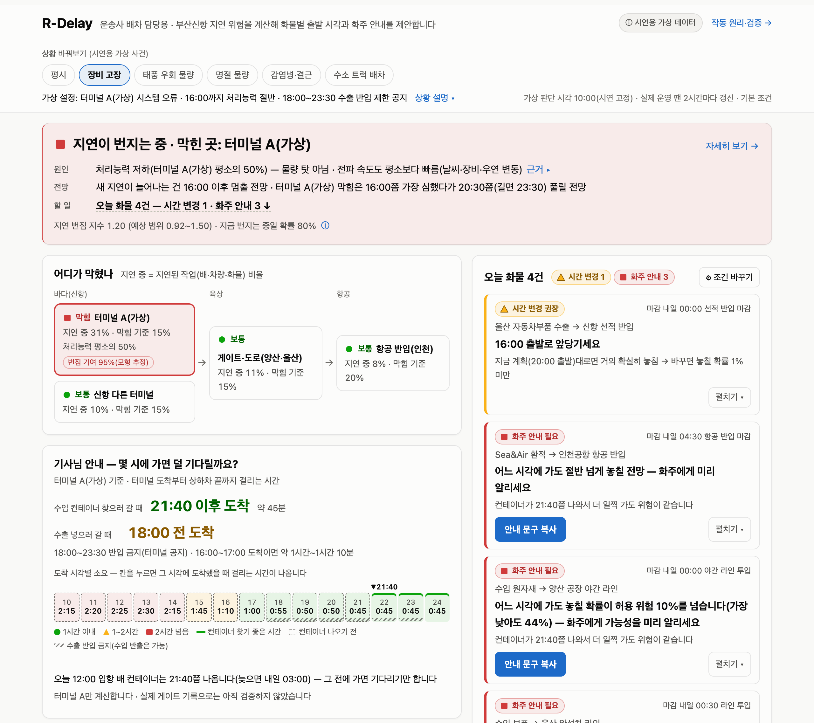
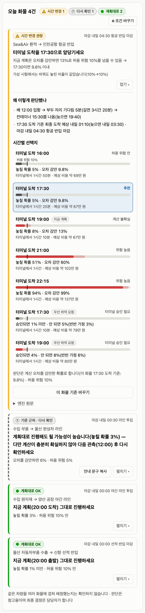
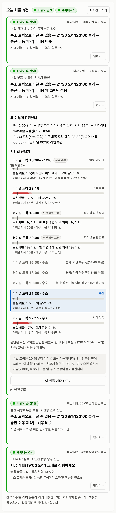
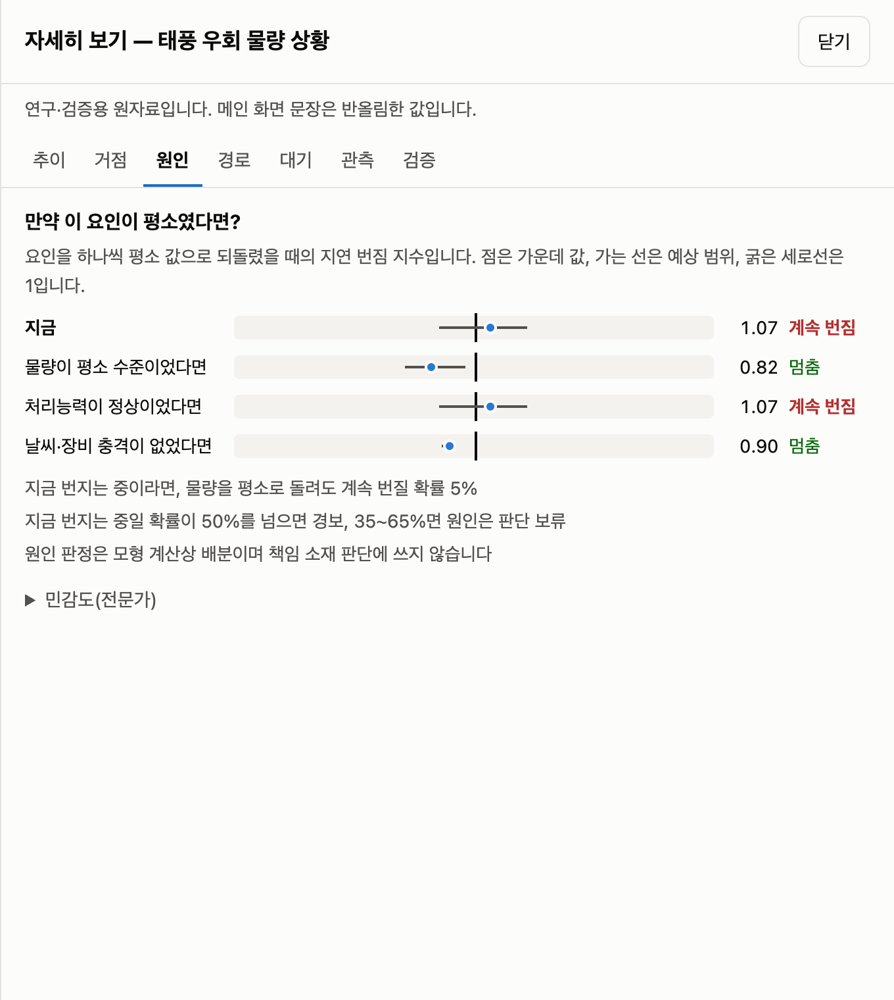
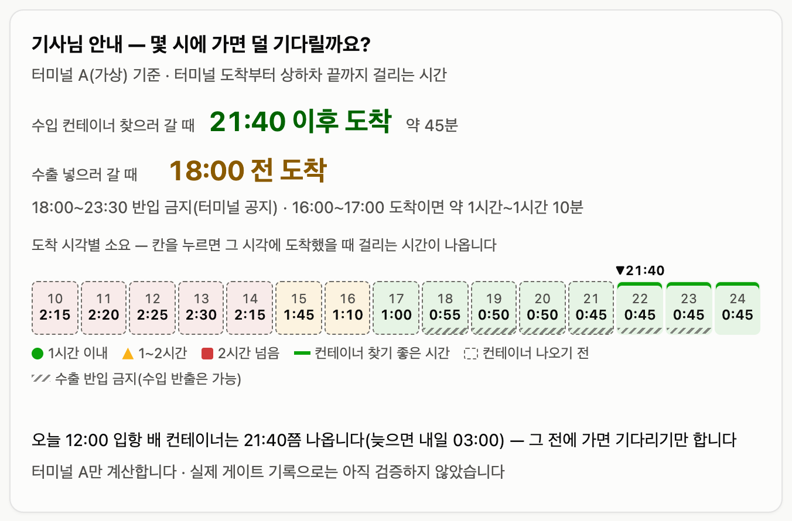
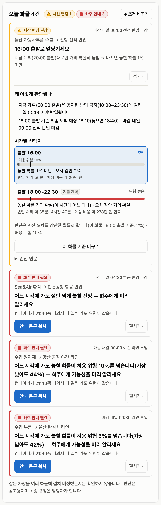
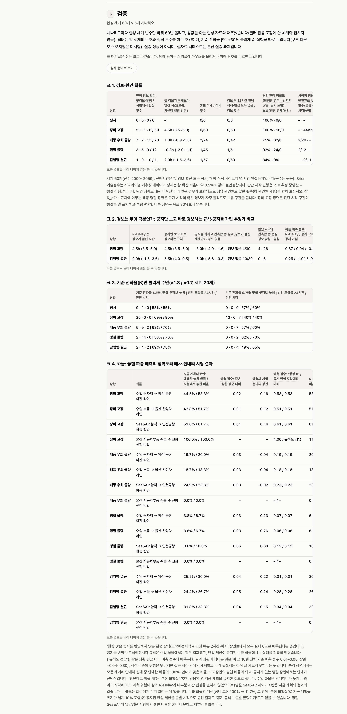
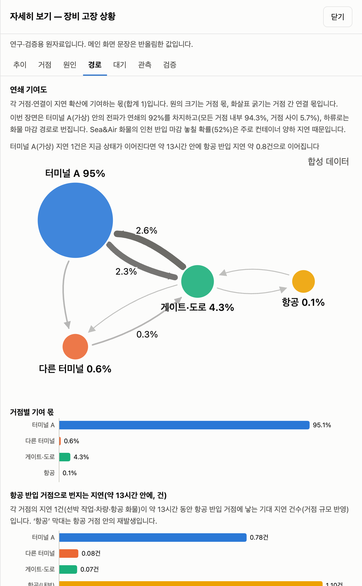
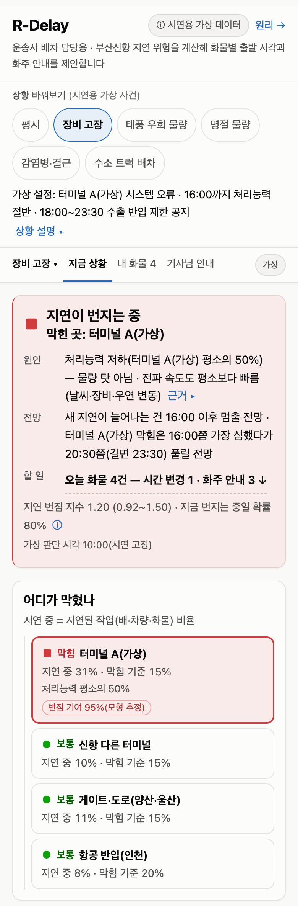

# R-Delay

**R-Delay: 감염병 확산 수리모델 기반 해상·육상·항공 연쇄지연 조기경보·배차결정 AI**

부산항 신항에서 시작된 지연이 게이트·도로(양산·울산)를 거쳐 항공 반입까지 번지는 과정을 감염병처럼 모델링합니다. 지연 1건이 새 지연을 몇 건 낳는지(연쇄지연 재생산수 $R_d$)를 관측으로 갱신해 **경보**를 내고, 원인이 **물량**인지 **처리능력·기상**인지 가르고, 화물별 **마감 실패확률**로 배차를 판단합니다. 확실하지 않으면 판정을 보류하고, 맞출 수 없으면 화주 사전 통보 문구를 냅니다.

AI($f_\omega$)는 기상·장비 상태로 전파율의 사전평균을 학습하는 보조 모듈이며, 경보·원인 판정·배차는 확률모형과 기회제약 규칙이 내립니다.

### ▶ 라이브 데모: https://shinshinjae.github.io/R-Delay/

> **합성 데이터 개념검증(TRL 3 수준)입니다.** 실데이터는 아직 연동하지 않았습니다. 화면의 수치는 공개 보도로 확인한 사건 유형을 본뜬 합성 자료로 계산했으며 **특정 터미널·기업의 자료나 판정이 아닙니다**(터미널 이름은 ‘가상 자동화 터미널 A’). 의사결정 지원용이며 최종 판단과 책임은 사용자에게 있습니다.
>
> 설치 없이 브라우저에서 열립니다. 계산 엔진(Python)은 [Pyodide](https://pyodide.org)로 브라우저 안에서 실행되며(설정을 바꾼 재계산 약 4초) 입력값은 어디에도 전송되지 않습니다. 화면 맨 아래에 ‘계산 엔진: 계산 준비됨 · 오프라인 가능’이 표시되면 인터넷 없이도 열립니다(휴대폰·태블릿은 **조건 바꾸기**를 한 번 열면 엔진 준비가 시작됩니다)(선상 본선 시연 대비, 로컬 서버를 끈 상태에서 재계산까지 확인).



화면은 운송사 배차 담당자가 한 번에 읽도록 **지금 상황(경보·원인·전망·할 일) → 오늘 화물(화물별 할 일과 화주 안내 문구) → 기사님 안내(몇 시에 가면 덜 기다리나) → 믿을 수 있나요?(잘 맞은 점과 한계)** 순서로 짜였습니다. 모형 수식·판정 규칙·검증 표는 따로 [작동 원리·검증](https://shinshinjae.github.io/R-Delay/method.html) 페이지에 있습니다.

---

## 목차

1. [대회 정보와 계획서 대비 현황](#대회-정보와-계획서-대비-현황)
2. [문제](#문제)
3. [해결: 경보 → 원인 → 배차](#해결-경보--원인--배차)
4. [누가 왜 쓰나](#누가-왜-쓰나)
5. [시연 장면](#시연-장면)
6. [검증: 합성 세계 60개](#검증-합성-세계-60개)
7. [핵심 수식](#핵심-수식)
8. [선행연구와 차별점](#선행연구와-차별점)
9. [데이터 확보 경로](#데이터-확보-경로)
10. [실증 로드맵과 KPI](#실증-로드맵과-kpi)
11. [GitHub에서 앱 확인하는 방법](#github에서-앱-확인하는-방법)
12. [로컬 실행·테스트·재생성](#로컬-실행테스트재생성)
13. [저장소 구조](#저장소-구조)
14. [한계](#한계)
15. [출처](#출처)
16. [팀](#팀)

---

## 대회 정보와 계획서 대비 현황

| 항목 | 내용 |
|---|---|
| 대회 | 2026 동남권 멀티도메인 모빌리티 비즈니스 해커톤 (개인부문) |
| 도메인 | ■ 해상(주) ■ 육상 ■ 항공 |
| 본선 | 2026.11.8.~11.10. 부산–오사카 선상 |
| 산출물 | 컨셉기획안(form-1), 웹 시연(이 저장소, GitHub Pages), 검증 리포트 |

| 계획서 항목 | 이 저장소의 현재 상태 | 본선·실증에서 할 일 |
|---|---|---|
| 3층(해상–육상–항공) 엔진, 되먹임 결합, 이중 경보 | 합성 시나리오로 동작(신항을 가상 자동화 터미널 A·타 터미널로 나눈 4거점) | 공개 입출항 이력(PORT-MIS)으로 정적 모수 IF2 추정, 실자료 대입 |
| 배차 담당자 화면(경보·원인·화물별 할 일·기사님 안내), 자세히 보기(기여도·원인 분해·경로·대기·관측·검증), 시나리오 | 6개 합성 시나리오 × 4종 화물, 화물차 기사용 반출 소요 | 거점 지도, 운송사 배차표 업로드·화물 입력, 차량 대수 배정 |
| 부산시용 배후도로 화물차 대기·주차 예보(주차면이 등록 화물차의 6%[22]), 태풍 상황판 | **미구현** | 본선·실증 과제(게이트 반출입·차량 위치·주차면 자료 필요) |
| 검증 ⓑ 합성 복원 | 합성 세계 60개 × 5개 시나리오, 공지 규칙·관측 단독·모수 오지정 비교([검증](#검증-합성-세계-60개)) | — |
| 검증 ⓐ 실자료 백테스트(선박 대기 12시간 초과 Brier·선행시간·오경보율, 현행 방식·순수 ML·축소 모형 비교) | **아직 하지 않음** | 본선 전·본선 과제 |

계획서 일정표의 각주대로 사전 준비 범위는 사무국 확인 후 확정하며, 준비분과 본선 작업은 Git 태그로 구분합니다.

## 문제

- **한 곳의 지연이 다음 거점으로 번집니다.** 신항 터미널 장비 보수 기간에 화물차가 장시간 대기했다는 보도[2], 터미널 시스템 오류 뒤 장치율이 치솟고 상하차가 몇 시간씩 걸렸다는 보도[3a]처럼 터미널 하나의 처리능력 저하가 게이트·도로·화주 공장으로 이어집니다. 한국해양진흥공사 특별보고서는 항만 간 혼잡 전이를 지적했습니다[4].
- **현장은 늦게 알고, 원인을 가르기 어렵습니다.** 운송사는 도착한 뒤에야 게이트 폐쇄·반입 제한을 통보받고[3b], 대기료는 사실상 받지 못한다고 말합니다[3d]. 같은 적체라도 물량이 몰려서인지(반입 시간대 분산) 처리능력이 떨어져서인지(장비·인력 보강, 우회)에 따라 대응이 다르고, 실제 사태에서는 원인 공방이 길어졌습니다[3e].
- **마감은 화물마다 다릅니다.** 완성차 라인은 부품 납품이 끊기면 가동과 중단을 반복합니다(2022년 화물연대 파업 사례, JIT 민감도 근거)[6]. 항공 환적 화물은 반입 마감을 넘기면 다음 편으로 밀립니다. 평균 지연이 아니라 **이 화물이 마감을 넘길 확률**이 필요합니다.

> 인터뷰 발언은 보도된 내용을 간접 인용했으며 직접 인터뷰가 아닙니다. 출처는 [출처](#출처)에 있습니다.

## 해결: 경보 → 원인 → 배차

| 단계 | 화면 | 하는 일 |
|---|---|---|
| ① 경보 | 경보 요약, 재생산수, 거점별 지연 | 2시간마다 들어오는 관측(신규 지연 건수, 현재 지연 표본)과 운영자 공지(선석 가동·장비·출근율)로 입자필터가 4거점 지연 상태와 $R_d$를 갱신. $P(R_d>1)\ge0.5$면 **확산 경보**, 지연 비율이 기준을 넘으면 **적체 경보** |
| ② 원인 | 전파 경로, 원인 분해 | 요인을 하나씩 평시 값으로 되돌린 반사실 $R_d$(물량 / 처리능력 / 기상·장비)로 무엇이 연쇄를 키우는지 보이고, 계획서 규칙(A7)으로 **물량 주도형 / 처리능력형 / 비확산** 판정. 확산 확률이나 원인 확률이 35~65%면 **보류**, 여러 요인이 각각 혼자서도 연쇄를 멈추면 **복합**으로 표시 |
| ③ 배차 | 마감위험 순위, 배차안 비교, 기사용 반출 소요 | 선석 대기열 → 컨테이너 양하 → 터미널 반출 → 도로 → (항공 반입 처리) 표본으로 배차안별 마감 실패확률을 계산. 상한이 허용 위험 ε 이하인 운송사 배차안 중 비용 최소안을 **추천**. 추정 오차 때문에만 기준을 넘으면 **추정 불확실(통보 보류)**, 어떤 안도 맞출 수 없으면 **추천 없음 + 화주 사전 통보 문구**. 선사·터미널 승인이 필요한 ‘우선 양하 요청’은 자동 추천하지 않고 ‘요청 시 기대 실패확률(승인 시 확률)’로만 표시 |

## 누가 왜 쓰나

| 사용자 | 화면에서 얻는 것 | 계획서의 사업화 연결 |
|---|---|---|
| 부산신항 출입 중소 운송사 배차 담당 | 오전 10시 화물별 마감위험 순위, 배차안 비교, 화주 통보 문구 | 1차 고객, 월 구독(가격 가설 기본 30만 원·프로 80만 원, 현장 검증 대상) |
| 화물차 기사 | 도착 시각별 터미널 반출 예상 소요(공지 처리능력 반영)와 권장 도착 시간대, 컨테이너 반출 가능 시각 | 무료 구간(항만 전체 경보·예상 대기)으로 사용자 유입 |
| 울산 완성차·부품사, 수소 트럭 운영사 | 라인 투입 실패확률(허용 위험 5% 기본), 수출 반입 마감 위험(공지된 반입 제한 반영), 디젤·수소 배차안 비교(복귀·충전·이동 제약) | 울산 수소 트랙터 실증[19] 자료 협력, 울산 AMR·PBV 물류 플랫폼[21]에 마감위험 API 공급 |
| 경남(양산 ICD·진해신항) 화주·물류 | 게이트·도로 구간 지연과 하류 증폭 | 신항~양산 ICD 실증, 진해신항 장비 고장 스트레스 테스트[16], 동남권 역할 분담[15] |
| 경남 항공부품(사천·진주) 화주·포워더 | (실증 ② 단계 구현 예정) 항공부품 공장 → 항공 반입 마감 실패확률. 지금 화면은 신항 환적 Sea&Air 화물만 계산 | 항공부품 긴급 납기를 ‘실패확률 ≤ ε’로 관리, 김해·가덕 Sea&Air[7][16] |
| 항만공사·부산시 | 확산·적체 이중 경보, 요인별 반사실(물량 대 처리능력·기상) | B2G 실증 용역·라이선스(원인 판정은 협의 참고자료이며 귀책 판단에 쓰지 않음) |
| 시도별 테크노파크 | 공개 코드·검증 리포트로 기술성숙도 확인 | ‘부울경 연쇄지연 관측망’ 데이터 협의체, 클러스터 시제품제작 지원 연계 |

항공 반입은 현행 인천 기준이며(항공화물의 인천 집중[7]), 노선이 늘면 김해·가덕 거점을 추가하는 구조입니다(로드맵 ④, [16]).

## 시연 장면

기본 설정(입자 512개, 합성 세계 20261108, 추정 시드 20261108)으로 미리 계산한 결과입니다. **세계 하나의 예시**이며 평균 성능은 [검증](#검증-합성-세계-60개)에 있습니다. 화물은 ‘수입 원자재 → 양산 공장 야간 라인(마감 내일 00:00)’ 기준입니다. 링크를 누르면 해당 화면이 열립니다.

| 시나리오 | $R_d$ 추정 (80% 구간) | $P(R_d>1)$ | 합성 참값 $R_d$ · 판정 | 경보 | 원인 판정 | 배차 판단 |
|---|---|---|---|---|---|---|
| [평시](https://shinshinjae.github.io/R-Delay/?s=base&c=import_factory) | 0.79 (0.67–0.94) | 5% | 0.87 · 비확산 | 정상 | 비확산 | 20:00 현행 계획 유지(실패 1.6%) |
| [자동화 터미널 장비 고장(가상)](https://shinshinjae.github.io/R-Delay/?s=terminal_failure&c=import_factory) | 1.20 (0.92–1.50) | 80% | 2.10 · 처리능력형 | 확산·적체 | 처리능력형 · 복합(처리능력+기상·장비) | 추천 없음 → 화주 사전 통보(실패 44%); 우선 양하 요청 시 기대 32%(승인되면 19%) |
| ↳ [같은 장면, 울산 수출 화물](https://shinshinjae.github.io/R-Delay/?s=terminal_failure&c=ulsan_export) | | | | | | 공지된 18:00~23:30 반입 제한 때문에 현행 20:00 출발은 실패 100% → **16:00 출발 추천** |
| [북중국 태풍 우회 물량](https://shinshinjae.github.io/R-Delay/?s=typhoon_diversion&c=import_factory) | 1.07 (0.86–1.22) | 66% | 1.30 · 물량 주도형 | 확산 | 물량 주도형 · 복합(물량+기상·장비) | 추천 없음 → 화주 사전 통보(실패 21%) |
| [명절 전 물량 급증](https://shinshinjae.github.io/R-Delay/?s=holiday_surge&c=sea_air) | 1.05 (0.91–1.25) | 60% | 1.08 · 물량 주도형 | 확산·적체 | **확산 경계(원인 판정 보류)** | 양산 화물 현행 유지(3.3%), Sea&Air는 17:30으로 앞당김, 울산 라인은 추정치(3.0%)가 허용 위험 5% 아래지만 판정에 필요한 정밀도를 입자 1024개로도 얻을 수 없어 **보수적으로 통보** |
| [감염병 검역·인력 결근](https://shinshinjae.github.io/R-Delay/?s=epidemic&c=import_factory) | 0.86 (0.73–1.03) | 15% | 1.17 · 처리능력형 | **적체만** | 비확산(**놓침**) · 적체 요인: 처리능력 저하 | 추천 없음 → 화주 사전 통보(실패 23%) |
| [수소 트럭 배차](https://shinshinjae.github.io/R-Delay/?s=h2_trucks&c=ulsan_parts) | 0.79 (0.67–0.94) | 5% | 0.87 · 비확산 | 정상 | 비확산 | 21:30 수소 트럭(20:00은 충전·경유·이동 뒤 20:15부터라 불가). 울산 수출은 차고지→공장 이동 때문에 20:45부터, 인천 반입은 1회 충전 주행거리 초과로 불가 |

- 장비 고장 장면의 참값 2.10은 80% 구간 밖입니다. 공지되지 않은 숨은 전파율 상승을 학습형 모듈의 사전평균이 작게 잡아 추정이 **지속적으로 낮게** 나오기 때문입니다(60개 세계 평균 편향 −0.23). 그래도 $P(R_d>1)=80\%$로 경보는 발령되고 원인 판정도 참값과 같습니다.
- 감염병 장면은 공지되지 않은 생산성 저하(10%)를 잡지 못해 확산을 놓친 사례입니다. 적체 경보와 ‘적체 요인: 처리능력 저하’가 대신 알립니다.
- 확산 확률이 경보 기준(50%)은 넘었지만 경계 구간(35~65%)이면 경보는 울리되 원인은 단정하지 않습니다(명절 장면).
- ‘추천 없음’은 실패가 아닙니다. 판단 시각(10:00)에 마감 14시간 전 화주·공장에 **미리 알리고 대체 수단을 준비할 근거**입니다. 수입 화물은 컨테이너 양하가 병목이라 운송사 배차 시각을 바꿔도 위험이 거의 그대로입니다.

| 마감위험 순위와 배차안 비교(명절, Sea&Air) | 디젤·수소 배차안 비교(울산 부품) |
|---|---|
|  |  |

| 요인별 반사실(태풍 우회 물량) | 기사님 안내: 도착 시각별 소요(장비 고장) |
|---|---|
|  |  |

| 공지된 반입 제한과 수출 출발 시각(장비 고장, 울산 수출) | 작동 원리·검증 페이지(합성 세계 60개) |
|---|---|
|  |  |

| 거점별 지연·전파 경로 | 모바일 화면 |
|---|---|
|  |  |

## 검증: 합성 세계 60개

`scripts/validate.py`로 시나리오마다 합성 세계 난수만 바꿔 60번 돌리고 합성 참값과 대조했습니다(세계 2000~2059, 필터 잡음 조정에 쓴 1000~1023과 겹치지 않음). **필터가 참 세계의 구조와 정적 모수를 아는 조건**이며, 기준 전파율 β̄만 틀리게 준 실험을 따로 보입니다(구조·다른 모수 오지정은 시험하지 않음). **합성 자료 결과이며 실증 성능이 아닙니다.**

### 경보·원인·확률

| 시나리오 | 판단 시각 확산 경보 (적중·오경보·미탐 / 참 확산) | 첫 경보 선행시간 중앙값 (사분위) | 경보 뒤 12h 안 사건 없음 | 원인 정확도(단정, 비확산 일치 포함) · 보류(확산/원인) | 참 원인별 재현 (물량 · 처리능력) | $P(R_d>1)$ Brier 기술점수 | 80% 포함률 24h / 판단 시각 | 판단 시각 편향 | AI 끔 → 켬 RMSE |
|---|---|---|---|---|---|---|---|---|---|
| 평시 | 0·0·0 / 0 | – | 0/0 | 100% · 0/0 | – | −0.55(참 확산 비율 0.5%, 불안정) | 89% / 93% | +0.03 | 0.099 → 0.092 |
| 자동화 터미널 장비 고장 | 53·1·6 / 59 | 4.5h (3.5~5.0) | 0/60 | 100% · 16/0 | – · 44/59 | 0.87 | 79% / **65%** | **−0.23** | 0.241 → 0.217 |
| 북중국 태풍 우회 물량 | 7·7·13 / 20 | 1.0h (−0.9~2.0) | 0/42 | 75% · 32/0 | **2/20** · – | 0.08 | 90% / 92% | +0.01 | 0.101 → 0.100 |
| 명절 전 물량 급증 | 3·5·9 / 12 | −0.3h (−2.0~1.1) | 1/51 | 92% · 24/0 | **2/12** · – | −0.04 | 90% / 92% | +0.02 | 0.105 → 0.099 |
| 감염병 검역·인력 결근 | 1·0·10 / 11 | 2.0h (−1.5~3.6) | 0/59 | 84% · 9/0 | – · **0/11** | 0.25 | 89% / 90% | −0.00 | 0.111 → 0.111 |

원인 정확도는 대부분 ‘비확산’끼리 맞은 경우에서 나옵니다. 정작 원인을 가려야 하는 세계에서 맞힌 비율(참 원인별 재현)은 장비 고장 처리능력형 44/59를 빼면 낮고, 대부분 ‘확산 경계’로 보류되거나 비확산으로 판정됐습니다. 단정한 ‘물량 주도형’은 6번 중 4번 맞았습니다(태풍 2/3, 명절 2/3).

### 경보는 무엇 덕분인가

| 시나리오 | R-Delay 첫 경보 선행시간 | **공지 즉시 경보 규칙** | 공지를 가린 관측 단독(경보가 울린 세계만) | 관측 단독 판단 시각 확산 경보 적중·미탐 | $P(R_d>1)$ Brier 기술점수: R-Delay / 공지 지시 규칙 / 공지 가림 |
|---|---|---|---|---|---|
| 자동화 터미널 장비 고장 | 4.5h | 4.5h | −3.0h, 경보 없음 4/30 | 4 · 26 (세계 30) | 0.87 / **0.94** / −0.21 |
| 감염병 검역·인력 결근 | 2.0h | **5.5h** | −5.0h, 경보 없음 10/30 | 0 · 6 (세계 30) | 0.25 / −1.01 / −0.20 |

장비 고장·감염병 장면의 조기 경보와 확률 품질은 **운영자 공지(선석 50%·장비 고장, 출근율 75%)를 받은 덕분**입니다. ‘공지가 오면 바로 경보’하는 단순 규칙이 선행시간에서 같거나 앞서고, 장비 고장에서는 ‘공지 중이면 확산 확률 1’이라는 지시 규칙의 Brier 점수가 모형보다 높습니다(감염병에서는 반대로 지시 규칙이 크게 나쁩니다). 공지를 가리면 관측만으로는 적체가 시작된 뒤 3~5시간이 지나서야 경보가 울리고, 판단 시각까지 울리지 않은 세계도 있습니다. 공지가 없는 물량 충격(태풍·명절)의 선행시간은 −0.3~1.0시간입니다. R-Delay가 더하는 것은 공지 자체가 아니라 **공지를 거점 간 전파와 화물별 마감 실패확률로 옮기는 것**입니다.

### 기준 전파율을 틀리게 주면(β̄만 ×1.3 / ×0.7, 세계 20개)

| 시나리오 | β̄ ×1.3: 적중·오경보·미탐 / 판단 시각 포함률 | β̄ ×0.7: 적중·오경보·미탐 / 판단 시각 포함률 |
|---|---|---|
| 자동화 터미널 장비 고장 | 20·0·0 / 90% | 13·0·7 / 40% |
| 북중국 태풍 우회 물량 | 5·9·2 / 70% | 0·0·7 / 60% |
| 명절 전 물량 급증 | 2·14·0 / 70% | 0·0·2 / 70% |
| 감염병 검역·인력 결근 | 2·4·2 / 75% | 0·0·4 / 65% |

기준 전파율을 30% 크게 주면 오경보가, 작게 주면 미탐이 크게 늘어납니다. 실증 전 IF2 정적 모수 추정이 반드시 필요한 이유입니다.

### 화물: 예측 정확도와 배차·통보의 실현 효과

현행 계획의 마감 실패확률 예측을 참 경로에서 한 번 실현한 결과와 비교했습니다.

| 시나리오 · 화물 | 예측 / 실현 실패 | 기술점수: 기후값 대비 | 예측·실현 상관 | 기술점수: 항상 0 / 공지 반영 ETA 대비 | R-Delay 추천을 따른 실현 실패 | 화주 통보 비율 · 정밀도 · 재현율 |
|---|---|---|---|---|---|---|
| 장비 고장 · 양산 | 44.5% / 53.3% | 0.02 | 0.16 | 0.53 / 0.53 | 53.3% (추천 변경 0%) | 100% · 53% · 100% |
| 장비 고장 · **울산 수출** | 100% / 100% | – | – | 1.00 / 규칙도 정답 | **11.7%** (추천 변경 90%, 체류 −1.3h) | 0% |
| 태풍 · Sea&Air | 24.9% / 23.3% | 0.03 | −0.02 | 0.23 / 0.23 | 23.3% (추천 변경 0%) | 100% · 23% · 100% |
| 명절 · Sea&Air | 8.6% / 10.0% | 0.05 | 0.30 | 0.12 / 0.12 | 10.0% (추천 변경 58%, 체류 +0.2h) | 17% · 20% · 33% |
| 명절 · 울산 라인 | 3.6% / 6.7% | 0.03 | 0.26 | 0.06 / 0.06 | 6.7% (추천 변경 0%) | 58% · 11% · 100% |
| 감염병 · 울산 라인 | 24.4% / 26.7% | 0.05 | 0.24 | 0.28 / 0.28 | 26.7% (추천 변경 0%) | 100% · 27% · 100% |

전체 표는 [작동 원리·검증](https://shinshinjae.github.io/R-Delay/method.html#valid) 페이지와 `docs/data/validation.json`에 있습니다. 읽는 법:

- ‘항상 0’은 공지를 반영하지 않는 현행 방식(도착예정시각 + 고정 여유 2시간)이 이 장면들에서 모두 실패 0으로 예측했다는 뜻입니다. 공지를 반영해 도착예정시각을 늦춘 규칙은 수입 화물에서는 같은 결과였고, 반입 제한이 공지된 수출 화물에서는 실패를 정확히 맞혔습니다. 이 기준 대비 점수는 **사건 수준의 위험을 알려 주는 가치**입니다.
- 같은 시나리오 안의 기후값 대비 기술점수(0.02~0.05)와 상관(−0.02~0.30)이 작다는 것은, **같은 사건 안에서 세계마다 누가 실패할지는 아직 잘 가르지 못한다**는 뜻입니다. 예측은 실현보다 낮은 경향이 있습니다.
- **화주 통보**: 충격 장면에서는 모든 세계에 통보하므로 재현율 100%, 정밀도 = 그 장면의 실패율입니다(세계별 선별이 아님). 명절 울산 라인은 추정이 불확실한 경우를 보수적으로 통보해 실패 4건을 모두 통보했지만 통보의 89%는 실패하지 않았고, 명절 Sea&Air는 통보가 선택적이었으나 실패의 1/3만 통보했습니다.
- **배차 변경의 실현 효과**: 수입 화물은 양하가 병목이라 추천 변경이 실현 실패를 줄이지 못했습니다(가치는 마감 14시간 전 통보). 수출 화물은 공지된 반입 제한을 출발 시각으로 옮겨 실현 실패가 100% → 11.7%로 줄었습니다(10%는 ‘추정 불확실’로 현행 유지). 이 개선은 ‘공지 규칙 + 출발 앞당기기’로도 얻을 수 있습니다. 명절 Sea&Air의 앞당김은 실현 실패를 줄이지 못하고 체류만 늘렸습니다.

## 핵심 수식

전체 정의·가정·증명은 [MODEL.md](MODEL.md)에 있습니다.

**① 물동량 보정 다층 SIS**(비율 단위) — 거점 $i$의 지연 비율 $x_i$:

$$
\frac{dx_i}{dt}=(1-x_i)\Big[\epsilon_i+\xi_i(t)\,\beta_i(t)\sum_j \tilde C_{ij}\,x_j\Big]-\gamma_i(t)\,x_i,\qquad \tilde C=I+\kappa\tau_0 M
$$

계획서 식(1)은 개수 단위 $\sum_j C_{ij}I_j$로 썼습니다. 여기의 $M$은 그것을 거점 규모로 환산한 $M=D_N^{-1}M_{\text{plan}}D_N$($D_N=\mathrm{diag}\,N$)이며 이 변환에서 동역학과 $R_d$가 같습니다. $\epsilon=0$이면 계획서 식과 같습니다.

**② 물동량 보정 계수**(후행 24시간 창):

$$
\xi_i(t)=\Big(\frac{L_i}{L_{\mathrm{ref}}}\Big)^{\theta} b_i(t),\qquad b_i(t)=\frac{1}{24}\int_{t-24}^{t}\frac{m_i(s)}{L_i\,h(s)}\,ds,\qquad m_i=\frac{X_i}{K_i}
$$

**③ 연쇄지연 재생산수와 판정**:

$$
R_d(t)=\rho\Big(\mathrm{diag}\big(\xi\beta(1-x)\big)\,\tilde C\,\Gamma^{-1}\Big),\qquad R_d^{(\xi=1)}=\rho\Big(\mathrm{diag}\big(\beta_\theta(1-x)\big)\,\tilde C\,\Gamma^{-1}\Big)
$$

판정: $P(R_d>1)<0.35$ → 비확산, $0.35\sim0.65$ → 확산 경계(원인 판정 보류), $>0.65$이면 확산 중인 경우의 $P(R_d^{(\xi=1)}>1\mid R_d>1)$가 $<0.35$ → 물량 주도형, $>0.65$ → 처리능력형(물량 외 요인: 처리능력·기상·장비), 그 사이 → 원인 보류. 외부 유입이 없을 때($\epsilon=0$) 지연 비율이 평형에 머물면 $R_d=1$이 되므로($\epsilon>0$이면 평형에서 $R_d<1$) 적체 경보($x_i>$ 기준)를 따로 둡니다.

**④ 학습형 전파율과 관측**:

$$
\beta_i=\bar\beta_i e^{z_i},\quad dz_i=a(\bar z_i-z_i)\,dt+\sigma\,dW_i,\quad \bar z_i=f_\omega(\text{풍속},\text{파고},\text{주말},\text{장비})
$$

$$
y_{i,k}\sim\mathrm{NB}(\lambda_{i,k},r),\qquad h_{i,k}\sim\mathrm{BetaBin}\big(n_i,\ \phi x_i(t_k),\ \phi(1-x_i(t_k))\big)
$$

$f_\omega$는 60일 합성 이력에서 입자 평활 사후평균을 레이블로 3회 반복 학습한 릿지 회귀입니다. 운영자가 아는 처리능력 정보(선석 가동·장비·출근율)는 추정하지 않고 해소율 $\gamma_i(t)$와 터미널 처리 속도에 직접 넣습니다.

**⑤ 기회제약 배차 결정**(배차안 $a$ = 시각, 동력원):

$$
a^\star=\arg\min_{a\in\mathcal A_{\mathrm{feas}},\ \hat p^{+}_q(a)\le\varepsilon}\Big\{c_a+c_w\,\mathbb E[W_q(a)]+c_f\,\hat p_q(a)\Big\},\qquad \hat p^{+}=\max\Big(\hat p+z_{0.95}\sqrt{\hat p(1-\hat p)/\mathrm{ESS}},\ 1-0.05^{1/\mathrm{ESS}}\Big)
$$

$\hat p$는 판단 시각의 가중 입자(재표본추출 전)를 그대로 예측 구간으로 보낸 가중 추정입니다. 상한은 계획서 식에 0건 경계 보정(3/n 규칙)을 더한 모형 안의 몬테카를로 오차 상한이며 모수·모형 오차는 포함하지 않습니다.

## 선행연구와 차별점

> **[P1]** *A mobility-informed SIR model for regional transmission dynamics: Evidence from subway mobility data in Korea, 2016–2023.* 한국자료분석학회지(Journal of the Korean Data Analysis Society) 최종원고, 2026. 공동 제1저자 연구. <!-- 서지 정보(저자·권·호·쪽)는 게재 확정·공저자 동의 후 기재 -->

| 선행연구[P1]에서 이어받은 것 | R-Delay에서 새로 만든 것 |
|---|---|
| 이동량 보정 계수 $\xi=(L_i/L_{\mathrm{ref}})^\theta b_i$의 구조 | 물동량/처리능력으로의 이전, 실시간용 후행 24시간 창([P1]은 사후 분석용 중심 7일 창) |
| 이동 기여와 고유 전파의 분리(θ 가정, [P1] 기준값 θ = 0.5) | 운영 기준 θ = 0과 민감도, 요인별 반사실, 두 단계 판정 보류, 복합 요인 표시 |
| 입자필터와 사후 평활의 비교 | 음이항+베타-이항 결합 관측, 학습형 평균을 갖는 로그-OU 전파율, 공지 입력 |
| — | 4거점 결합행렬 $\tilde C$, 연쇄지연 재생산수 $R_d$, 시간가변 선석 대기열, 화물별 마감 실패확률과 기회제약 배차 |

[P1]은 인플루엔자·지하철 자료 연구로 물류를 다루지 않습니다. [P1]의 ‘RMSE 73% 감소’는 단일 합성 시나리오에서 사후 평활을 실시간 필터와 비교한 값이며 실시간 성능이 아닙니다.

## 데이터 확보 경로

| 모델 입력 | 운영 정의(실증 시) | 출처 | 주기 | 확보 |
|---|---|---|---|---|
| 신규 지연 건수 $y$ (해상·육상) | 선석 계획 대비 접안 지연, 예약 대비 반출입 지연, 반입 마감 초과 건수 | PORT-MIS 입출항 이력(공개) / 터미널 반출입·VBS 예약(협약) | 1~2시간 | 공개 일부, 나머지 협약 필요 |
| 현재 지연 표본 $h/n$ (해상·육상) | 표본 선박·차량·화물 중 지연 상태 수 | AIS·선석 계획, 게이트 반출입(협약) | 1~2시간 | 협약 필요 |
| 항공 반입 지연 $y_A$, $h_A$ | 화물터미널 반입 처리 지연·마감 초과 | 인천공항 화물터미널 운영사·포워더 반입 처리 기록(협약) | 편별 | **미확보**(Sea&Air 결과는 사전 가정) |
| 물동량 $X$, 처리능력 $K$ | 시간당 반출입·하역량, 가동 선석·장비 | 터미널별 월 처리량(공개, 월 단위) / 시간 단위는 운영사(협약) | 시간 | 시간 단위는 협약 필요(공개 대체: 월 처리량 + 시간대 계절지수) |
| 공지 처리능력·반입 제한 | 선석 가동·장비 고장·출근율·게이트 반입 제한 공지 | 터미널 운영 공지, 체인포털(협약) | 사건 시 | 협약 필요 |
| 기상 | 풍속·파고 | 기상청·해양기상 API(공개) | 1시간 | 공개 |
| 도로 소요·지연 | 구간 통행시간 | 고속도로 교통량(공개) / ITT·차량 위치(협약) | 15분~1시간 | 공개 일부 |
| 배차안·동력원·마감 | 화물별 반출 시각, 차량(디젤/수소), 마감 | 운송사 배차표 업로드 또는 컨테이너 번호·선명·마감 3항목 입력 | 일 | 고객 입력 |

본선 전에는 공개자료(입출항 이력)만으로 가능한 ‘선박 대기 12시간 초과’ 백테스트를 먼저 수행합니다. 이 백테스트는 선석 대기열 구성요소만 검증합니다.

## 실증 로드맵과 KPI

| 단계 | 대상 | 필요 데이터·파트너(협약 상태) | 구성요소별 기술성숙도 | 통과 기준 |
|---|---|---|---|---|
| ① 2026.11 본선 | MVP, 공개자료 백테스트 | PORT-MIS·기상 공개자료(확보 가능) | 대기열 TRL 3→4, $R_d$ 경보 TRL 3→4, 배차 TRL 3 | 공개 입출항 12개월 백테스트에서 ‘선박 대기 12시간 초과’에 대해 (a) 예측이 공지 반영 ETA 규칙 대비 Brier 기술점수 ≥ 0.1, (b) 경보 선행시간·오경보율 측정 |
| ② 2027 상반기 | 부산 법인 설립, 울산 전력구동·경남 항공부품 기업과 컨소시엄으로 클러스터 시제품제작 지원[13] 도전, 신항~양산 ICD·울산 구간 실증 | BPA·운영사 데이터 협약(협의 전), 울산 수소 트랙터 실증 자료 협력(협의 전), 인천공항 화물터미널·포워더(협의 전) | 경보 TRL 4→5, 배차 TRL 4 | 협약 자료 3개월 오프라인 재현에서 경보 선행시간 중앙값 ≥ 2h·오경보율 ≤ 20%이고, **공지 즉시 경보 규칙 대비 선행시간 개선 ≥ 0** |
| ③ 2027~28 | 진해신항 장비 고장 스트레스 테스트[16], 울산 AMR·PBV 플랫폼 API[21] | 진해신항 운영사(협의 전), 울산 물류 플랫폼(협의 전) | TRL 6 | 운송사 3곳 섀도 운영에서 마감위험 Brier 기술점수 ≥ 0.2(현행 방식 대비)이고 **시나리오 기후값 대비 > 0(신뢰구간 하한)** |
| ④ 2028~ | 김해공항·부산–오사카 항로, 2035 가덕도 Sea&Air 디지털트윈[16] | 공항·항로 운영 자료(협의 전) | TRL 7 목표 | 실증 KPI 4개를 1년간 충족 |

실증 1년 KPI(계획서와 같음): 경보 선행시간 중앙값 2시간 이상(오경보율 20% 이하, 사건 = 선박 대기 12시간 초과) · 마감위험 Brier 기술점수 0.2 이상(현행 방식 대비) · 참여 운송사 차량 터미널 체류 10% 감소 · 실증 참여 10곳·유료 전환 3곳. 무료(항만 전체 경보·예상 대기)와 유료(화물별 마감위험·배차 비교·대기 기록)의 경계도 계획서와 같습니다.

## GitHub에서 앱 확인하는 방법

1. 저장소 첫 화면 위쪽의 **라이브 데모 링크**(https://shinshinjae.github.io/R-Delay/)를 누릅니다. 오른쪽 **About**의 링크, 또는 **Settings → Pages**의 "Your site is live at" 주소도 같습니다.
2. 처음 열면 미리 계산된 결과(자동화 터미널 장비 고장 장면)가 바로 보이고, 화면 맨 아래 상태가 "계산 엔진: 계산 준비됨 · 오프라인 가능"으로 바뀌면 화물 목록의 **조건 바꾸기**에서 설정을 바꿔 다시 계산할 수 있습니다. 휴대폰·태블릿(폭 1024px 미만)에서는 **조건 바꾸기**를 열면 엔진 준비가 시작됩니다. 모형 설명과 검증 표는 오른쪽 위 **작동 원리·검증**에 있습니다.
3. 특정 장면은 주소로 바로 엽니다: `?s=<시나리오>&c=<화물>` (예: `?s=terminal_failure&c=ulsan_export`). 시나리오: `base`, `terminal_failure`, `typhoon_diversion`, `holiday_surge`, `epidemic`, `h2_trucks` / 화물: `import_factory`, `ulsan_parts`, `sea_air`, `ulsan_export`. 고급 설정: `eps=ulsan_parts:0.03`, `cost=ulsan_parts:500`(만원), `h2=1`(수소 비교), `world=7`, `seed=7`, `n=1024`, `kappa=1.5`.
4. 코드가 바뀌면 **Actions** 탭의 CI가 테스트를 돌리고, Pages는 `main` 브랜치의 `docs/` 폴더를 다시 배포합니다(1~2분). 배포 직후에도 엔진·데이터 파일은 서버에 다시 확인해 받으므로 옛 파일과 섞이지 않습니다.

### 저장소 올리기와 Pages 켜기(관리자용)

```bash
cd R-Delay
git init -b main
git add .
git commit -m "R-Delay: 연쇄지연 조기경보·배차결정 웹 시연(합성 개념검증)"
gh repo create R-Delay --public --source=. --push
gh api -X POST "repos/{owner}/{repo}/pages" -f "source[branch]=main" -f "source[path]=/docs"
```

웹에서 할 때: 저장소 **Settings → Pages → Build and deployment → Source: Deploy from a branch → Branch: `main`, 폴더: `/docs` → Save**. 예선 시점 스냅샷은 Release 태그로 남깁니다(태그 이름은 계획서 표기와 맞춤).

## 로컬 실행·테스트·재생성

```bash
python3 -m http.server -d docs 8000      # http://localhost:8000 에서 열기
python3 -m pip install -r requirements.txt
python3 -m pytest -q                     # 엔진 테스트 46개
node --test tests/*.test.mjs             # 화면 문구 규칙 테스트(Node 22+)
node scripts/check-assets.mjs            # 화면 파일 버전 점검: css·js를 고치면 docs/sw.js의 V와 모든 ?v=를 올린 뒤 --write
python3 scripts/train_ai.py              # 학습형 전파율 모듈 재학습(약 2분) → docs/data/ai_model.json
python3 scripts/build_data.py            # 6개 시나리오 미리 계산(약 4초) → docs/data/precomputed.json
python3 scripts/validate.py              # 합성 세계 검증(8코어 약 1분) → docs/data/validation.json
node scripts/screenshots.mjs http://localhost:8000 docs/assets/img   # 화면 캡처(Chrome 필요)
```

엔진만 쓸 때:

```python
import sys, json; sys.path.insert(0, "docs/py")
from rdelay import api
model = json.load(open("docs/data/ai_model.json"))
out = api.run({"scenario": "terminal_failure", "cargo": "ulsan_parts", "epsilon": 0.05}, ai_model=model)
print(out["now"]["alarm"], out["now"]["cause"], out["cargo"]["ulsan_parts"]["decision"]["message"])
```

## 저장소 구조

```
R-Delay/
├── docs/                      # GitHub Pages 루트(웹 앱 전체)
│   ├── index.html             # 배차 담당자 화면
│   ├── method.html            # 작동 원리·검증(수식·판정 규칙·검증 표)
│   ├── sw.js                  # 오프라인 캐시(서비스 워커)
│   ├── assets/css·js·img      # 화면, SVG 차트, Pyodide 워커, 캡처
│   │                          #   js/derive.js: 엔진 결과 → 화면 문구 규칙(순수 함수)
│   ├── data/precomputed.json  # 6개 시나리오 미리 계산 결과(4종 화물 포함)
│   ├── data/validation.json   # 합성 세계 검증 결과
│   ├── data/ai_model.json     # 학습형 전파율 모듈 계수·평가
│   └── py/rdelay/             # Python 엔진(브라우저와 로컬이 같은 코드)
│       ├── sis.py             #   다층 SIS, R_d, 탄력성, 하류 증폭(개수 단위)
│       ├── volume.py          #   물동량 보정 ξ(후행 창)
│       ├── ai.py              #   f_ω 특징·릿지 회귀
│       ├── engine.py          #   합성 참 경로, 관측, 입자필터·평활, 가중 예측
│       ├── queue.py           #   시간가변 M(t)/M(t)/m 전진방정식, 대상 선박·컨테이너
│       ├── cargo.py           #   수입·수출·항공 경로, 반입 제한, 수소 트럭 조건, 기회제약 배차
│       ├── stats.py           #   음이항·베타-이항, 재표본추출, ESS 상한
│       ├── config.py          #   거점·결합·시나리오·화물 설정(합성 가정)
│       └── api.py             #   run(): 웹·스크립트 공용 진입점(공지 가림·모수 오지정 검증 선택지 포함)
├── scripts/                   # 학습, 미리 계산, 검증, 화면 캡처
├── tests/test_engine.py       # 엔진 검증 테스트
├── tests/derive.test.mjs      # 화면 문구 규칙 테스트
├── MODEL.md                   # 모델 상세
└── .github/workflows/ci.yml   # 테스트 자동 실행
```

## 한계

- **합성 데이터, 아는 모수**: 거점 규모·결합 계수·비용 단가·승인 확률·충전소 조건은 가정값이고, 검증은 필터가 참 정적 모수를 아는 조건입니다. 기준 전파율만 ±30% 틀리게 줘도 오경보·미탐이 크게 늘었고, 구조·다른 모수의 오지정은 아직 시험하지 않았습니다.
- **조기 경보의 근원**: 처리능력 충격의 조기 경보는 운영자 공지 덕분이며, 관측만으로는 적체 시작 뒤에야 잡힙니다. 물량 충격(태풍·명절)에서도 선행시간 가운데 값이 −0.3~1.0시간으로 경보가 거의 앞서지 않습니다(명절은 보통 적체 시작 뒤 경보).
- **공지되지 않은 충격**: 학습형 모듈의 장비 고장 계수가 평활 레이블의 수축으로 참값의 29~60%로 작게 추정되고, 숨은 전파율 상승·생산성 저하는 하향 편향(장비 고장 장면)과 확산 미탐(감염병 장면)을 낳습니다.
- **세계별 판별력**: 화물 실패확률은 사건 수준의 위험을 알려 주지만 같은 사건 안의 세계별 판별력은 약하고, 실현보다 낮게 예측하는 경향이 있습니다.
- **배차 변경의 효과**: 수입 화물은 양하가 병목이라 배차 시각 변경으로 실현 실패가 줄지 않았습니다. 공지된 반입 제한 같은 운송사 쪽 제약이 있을 때만 효과가 컸습니다. 화물별로 따로 평가하므로 차량 대수 제약은 반영하지 않습니다.
- **대기열 적용 범위**: 정기선 선석 윈도 배정과 달라 윈도를 벗어난 선박의 대기에만 적용합니다.
- **원인 판정은 모형상 배분**입니다. 귀책 판단에 쓰지 않습니다.

## 출처

문제 정의와 지역 연계에 쓴 공개 보도(2026-10-22 원문 대조). 인터뷰 발언은 기사 보도 내용을 간접 인용했습니다.

| 번호 | 출처 | 날짜 | 링크 |
|---|---|---|---|
| [1] | 부산일보(다음뉴스), 작년 부산항 컨테이너 물동량 2488만 TEU 역대 최대 | 2026-01-29 | https://v.daum.net/v/20260129110326732 |
| [2] | 연합뉴스(네이트), 신항 7부두 장비 보수·화물차 장시간 대기 | 2026-09-05 | https://news.nate.com/view/20260905n04577 |
| [2] | 서울신문, 개항 150년 부산항 '지능형 AI 항만' | 2026-05-13 | https://m.go.seoul.co.kr/news/2026/05/13/20260513022002 |
| [3] | 데일리로그, 미선적 약 2,000개(추정)·운임 상승 | 2026-08-04 | https://www.dailylog.co.kr/news/articleView.html?idxno=26665 |
| [3a] | 데일리로그, 터미널 시스템 오류 셧다운·장치율·상하차 지연 | 2026-07-10 | https://www.dailylog.co.kr/news/articleView.html?idxno=26623 |
| [3b] | 데일리로그, 운송업계 — 도착 후 게이트 폐쇄 통보 | 2026-09-10 | https://www.dailylog.co.kr/news/articleView.html?idxno=26752 |
| [3c] | 데일리로그, 구역별 처리시간 30분~2시간 이상 | 2026-07-22 | https://www.dailylog.co.kr/news/articleView.html?idxno=26642 |
| [3d] | 데일리로그, 대기료 지급 0건 | 2026-09-15 | https://www.dailylog.co.kr/news/articleView.html?idxno=26760 |
| [3e] | 데일리로그, 셧다운 3개월째·4자 회의·원인(처리능력·물량) | 2026-10-08 | https://www.dailylog.co.kr/news/articleView.html?idxno=26803 |
| [4] | 파이낸셜뉴스 영문판, 한국해양진흥공사 특별보고서(항만 간 혼잡 전이) | 2026-09-04 | https://en.fnnews.com/news/202609040955280936 |
| [4] | 트레드링스, 아시아 14개 항만 정시성 | 2026-09-08 | https://www.tradlinx.com/blog/?p=24755 |
| [5] | The Maritime Executive, Congestion Grows in Yantian Port due to COVID-19 | 2021-06-03 | https://maritime-executive.com/article/congestion-grows-in-china-s-yantian-port-due-to-covid-19-outbreak |
| [6] | 노컷뉴스, 화물연대 파업 중 부품 납품 차질로 현대차 울산공장 라인 가동·중단 반복 | 2022-06-09 | https://www.nocutnews.co.kr/news/5769439 |
| [7] | 트윅24, 가덕도신공항 화물(항공화물 인천 집중) | 2026-06-28 | https://twig24.com/news/2026/06/29/20260629022002 |
| [8] | 부산일보, 컨테이너 배차 담당자 국민청원(접안 지연, 임시보관 10만~20만 원) | 2021-06-24 | https://www.busan.com/view/busan/view.php?code=2021062415042358760 |
| [9a] | 이투데이, 한국무역협회 573개사 설문 | 2024-07-14 | https://www.etoday.co.kr/news/view/2379792 |
| [9b] | 데일리안, 부산 자동차부품 수출 중소기업 인터뷰 | 2024-02-10 | https://www.dailian.co.kr/news/view/1327217/ |
| [10] | 한국경제, BPA 체인포털·VBS 현황 | 2025-11-26 | https://www.hankyung.com/article/2025112660321 |
| [13] | 2026 동남권 지역혁신클러스터육성사업(비R&D) 통합공고(울산TP 게시) | 2026-04-27 | https://www.utp.or.kr (사업공고 게시판) |
| [15] | 노컷뉴스, 동남권 4대 성장엔진(부산·울산·경남 역할) | 2026-08-26 | https://nocutnews.co.kr/news/6568647 |
| [16] | 헤럴드경제(진해신항) / SBS Biz(가덕도신공항 2035) / 메트로신문(가덕도 기본계획 Sea&Air) | 2026-01-28 / 2026-09-07 / 2023-12-28 | https://www.heraldk.com/article/2026012818141912734 · https://biz.sbs.co.kr/amp/article/20000333212 · https://www.metroseoul.co.kr/article/20231228500120 |
| [19] | 서울신문, 울산 수소전기 트랙터 실증(울산~부산·양산, 1회 충전 761km) | 2025-12-02 | https://m.seoul.co.kr/news/2025/12/02/20251202500193 |
| [21] | 헤럴드경제, 울산TP AMR·PBV 지역혁신클러스터 사업(국비 225억 원) | 2026-06-04 | https://www.heraldk.com/article/2026060416572771114 |
| [22] | 부산일보, 화물차 주차면 등록 차량의 6% | 2025-06-11 | https://www.busan.com/view/busan/view.php?code=2025061118143293559 |

수소 트럭의 1회 충전 주행거리(761km)는 [19]의 값이고, 복귀 시각·잔여 거리·충전소 운영시간·차고지 이동은 **합성 가정**입니다. 실증 참여를 뜻하지 않습니다.

라이브러리: [Pyodide](https://pyodide.org) 0.27.2(MPL-2.0), [NumPy](https://numpy.org)(BSD-3-Clause), [KaTeX](https://katex.org) 0.16.11(MIT). 코드: [MIT License](LICENSE).

## 팀

| 이름 | 이메일 |
|---|---|
|신재완|sjw6258@g.kmou.ac.kr|
|명정효|karl0126@naver.com|
|김진현|jinh7205@naver.com|
|김태훈|kth060420@gmail.com|
