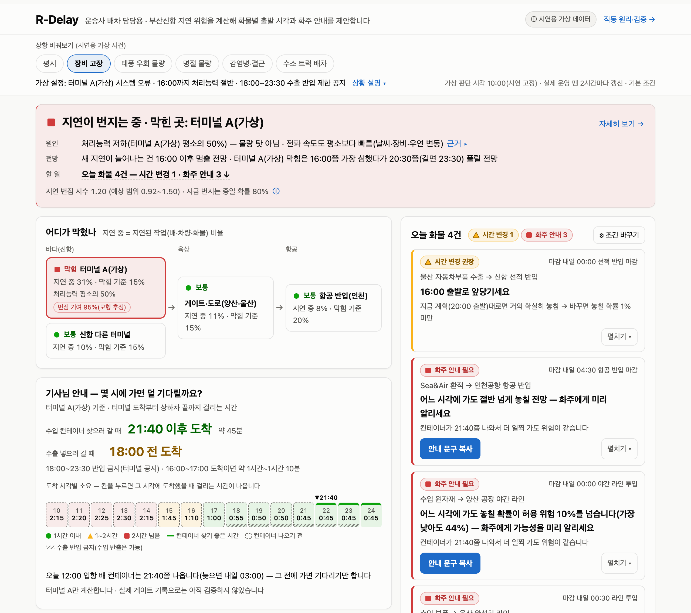
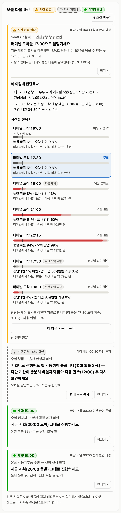
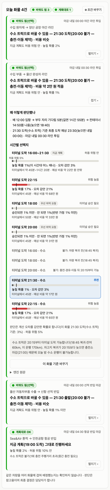
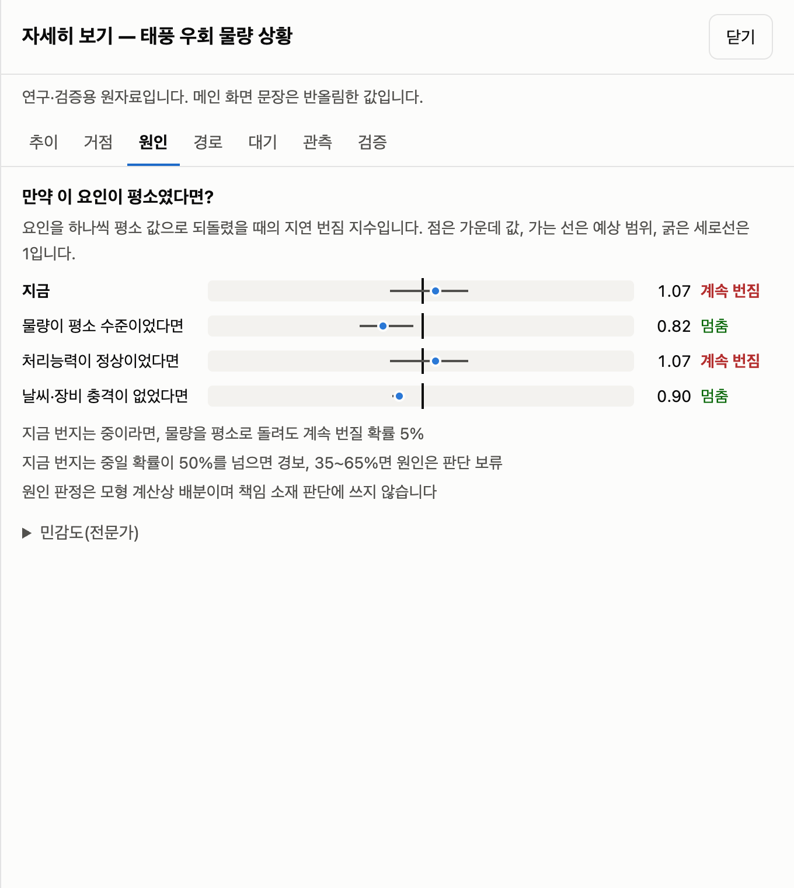
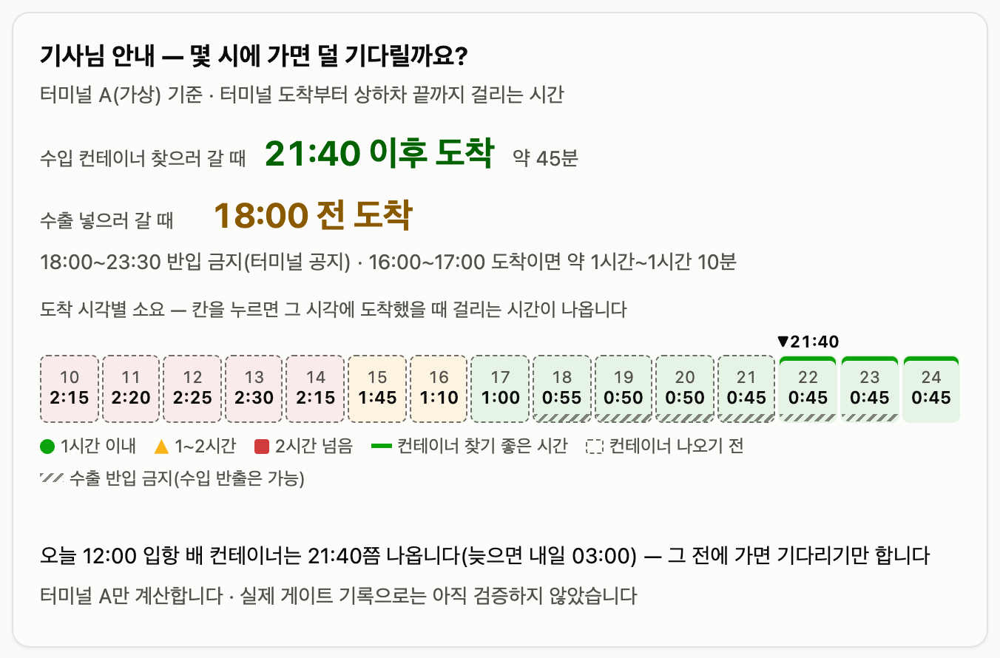
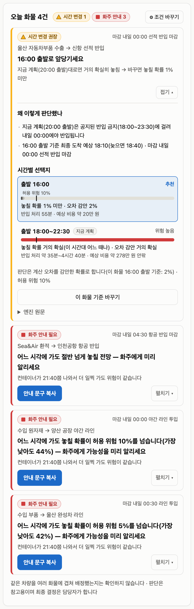
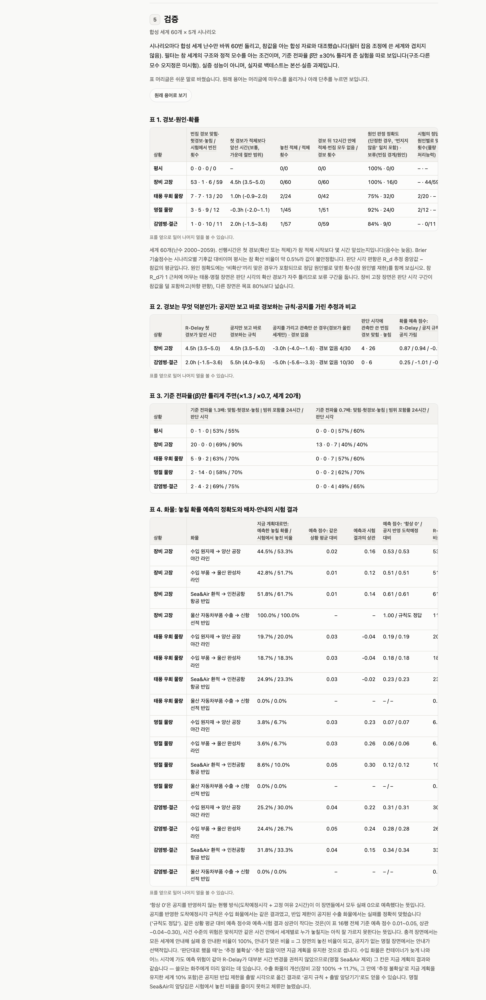
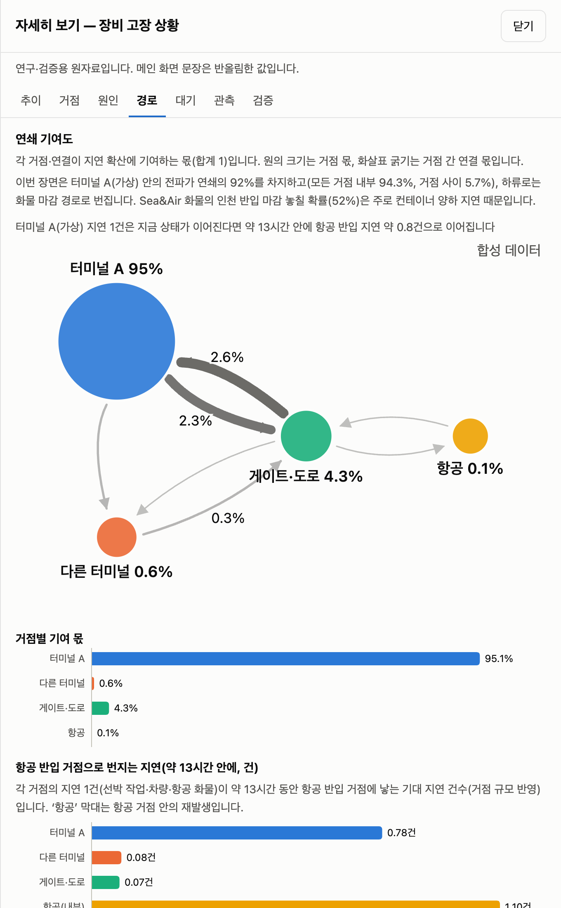
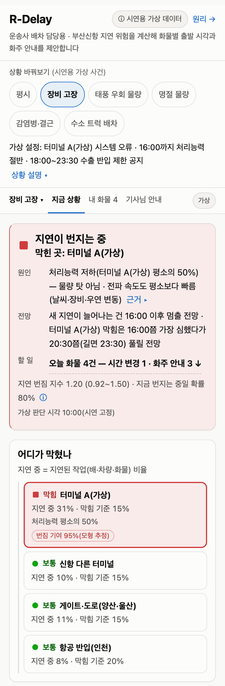

# R-Delay 기술 보고서

> [README](README.md)의 자세한 판입니다. 문제 정의·해결 구조·시연 장면별 결과·합성 세계 검증·실제 공개 자료 백테스트·핵심 수식·선행연구·데이터 확보 경로·로드맵·한계·출처를 담았습니다. 모형 정의와 증명은 [MODEL.md](MODEL.md)에 있습니다.

**R-Delay: 감염병 확산 수리모델 기반 해상·육상·항공 연쇄지연 조기경보·배차결정 AI**

부산항 신항에서 시작된 지연이 게이트·도로(양산·울산)를 거쳐 항공 반입까지 번지는 과정을 감염병처럼 모델링합니다. 지연 1건이 새 지연을 몇 건 낳는지(연쇄지연 재생산수 $R_d$)를 관측으로 갱신해 **경보**를 내고, 원인이 **물량**인지 **처리능력·기상**인지 가르고, 화물별 **마감 실패확률**로 배차를 판단합니다. 확실하지 않으면 판정을 보류하고, 맞출 수 없으면 화주 사전 통보 문구를 냅니다.

AI($f_\omega$)는 기상·장비 상태로 전파율의 사전평균을 학습하는 보조 모듈이며, 경보·원인 판정·배차는 확률모형과 기회제약 규칙이 내립니다.

### ▶ 라이브 데모: https://shinshinjae.github.io/R-Delay/

> **본선판 v3.0 (2026-11-09)** — 주 사용자를 **중소 포워더(수출입 담당자)**로 바꿨습니다. 엔진·계산 결과(`docs/data/precomputed.json`)는 그대로이고 화면 문구와 문서만 바꿨습니다.
> - `index.html` **포워더 브리핑**: 「오늘 관리 화물」 판(줄마다 화주 이름), 문서 4종을 **화주 안내 · 배차 요청(협력 운송사) · 사내 보고 · 선사·터미널 협의**로 바꿈. 배차 요청에는 운송사가 기사님께 전달할 기사님 화면 링크가 들어갑니다.
> - 선사·터미널 협의 문서에 **요청 사항**(우선 하역이 받아들여지면 놓칠 확률이 얼마나 줄어드는지, 반입 제한 공지에 맞춘 출발 시각)을 엔진 출력으로 적습니다.
> - 서비스 워커 캐시 이름을 `rdelay3-`로 바꿔 같은 출처의 R-Delay·R-Delay_ver2와 캐시를 서로 지우지 않게 했습니다.
> - 사업화 우선순위: ① B2G(항만공사·부산시) ② 중소 포워더 ③ 부산신항 출입 중소 운송사 ④ 부울경 화주. 첫 단계는 팬스타 크루즈선(부산–오사카)과 중소 포워더 대상 **무료 시범운영**입니다(아래 [누가 왜 쓰나](#누가-왜-쓰나)).

> **본선판 v2.0 (2026-11-04)** — 배차 담당자 중심으로 화면을 다시 짰습니다.
> - `index.html` **배차 브리핑**: 상황 띠(해상→육상→항공) + 시간축 하나에 오늘 화물을 줄 세운 배차판(지금 계획·추천 시각·마감·반입 금지·반출 예상). 줄을 누르면 오른쪽에 문서가 만들어집니다.
> - **상황별 브리핑 초안 4종**(`assets/js/briefing.js`): 화주 안내 · 기사 지시 · 사내 보고 · 항만 협의. 숫자는 모두 엔진 출력에서 오며, 고친 문구 그대로 복사·공유(카톡)·인쇄(PDF)·텍스트 저장. 테스트 `tests/briefing.test.mjs`.
> - `driver.html` **기사님 화면**: 배차 담당이 보내는 링크로 열리는 휴대폰 화면(큰 글씨 도착 시각 + 시각별 소요 띠).
> - **앱으로 설치(PWA)**: `manifest.webmanifest`·아이콘 추가, 서비스 워커가 새 화면·글꼴까지 오프라인 저장. 별도 앱 스토어 앱 없이 홈 화면에 설치됩니다.
> - 기존 상황판은 `analysis.html`(분석 화면)으로 그대로 남겼습니다. 글꼴: Pretendard(KS X 1001 부분집합)·Barlow Semi Condensed, 둘 다 SIL OFL(`assets/fonts/`).

> **화면은 합성 데이터 개념검증(TRL 3 수준)입니다.** 화면에는 실데이터를 연동하지 않았습니다. 화면의 수치는 공개 보도로 확인한 사건 유형을 본뜬 합성 자료로 계산했으며 **특정 터미널·기업의 자료나 판정이 아닙니다**(터미널 이름은 ‘가상 자동화 터미널 A’). 부산신항 공개 자료로는 선박 대기 예측을 따로 되돌려 검증했습니다(공개 실자료 후향 검증, 실시간 운영 검증 아님, 아래 요약). 의사결정 지원용이며 최종 판단과 책임은 사용자에게 있습니다.
>
> 설치 없이 브라우저에서 열립니다. 계산 엔진(Python)은 [Pyodide](https://pyodide.org)로 브라우저 안에서 실행되며(설정을 바꾼 재계산 약 4초) 입력값은 어디에도 전송되지 않습니다. 화면 맨 아래에 ‘계산 엔진: 계산 준비됨 · 오프라인 가능’이 표시되면 인터넷 없이도 열립니다(휴대폰·태블릿은 **조건 바꾸기**를 한 번 열면 엔진 준비가 시작됩니다)(선상 본선 시연 대비, 로컬 서버를 끈 상태에서 재계산까지 확인).

> **실제 공개 자료 백테스트 요약**([자세히](#검증-실제-공개-자료-백테스트)) — 평가 기간(2025-07-01 \~ 2026-10-29, 판단 시각 5,821개)에 ‘앞으로 24시간 안에 12시간 넘게 기다릴 컨테이너선이 오는가’를 맞힌 정도(PR-AUC)는 R-Delay 0.407, 지속성(지금 정박지 대기) 0.387, 기후값 0.291입니다. 기후값보다는 확실히 낫지만 지속성과는 차이가 없고, 대기 에피소드 81개 중 63개는 시작 전 72시간 안에 경보가 없었습니다. 앱의 확산 경보($P(R_d>1)\ge0.5$)는 실자료에서 한 번도 울리지 않았습니다($P(R_d>1)$ 최대 0.0019). 스케줄 기준선에 R-Delay 상태를 더하면 조금 나아집니다(PR-AUC 차이 95% 구간 +0.003–+0.066).



분석 화면(`analysis.html`)은 포워더 담당자가 한 번에 읽도록 **지금 상황(경보·원인·전망·할 일) → 오늘 화물(화물별 할 일과 화주 안내 문구) → 기사님 안내(몇 시에 가면 덜 기다리나) → 믿을 수 있나요?(잘 맞은 점과 한계)** 순서로 짜였습니다. 모형 수식·판정 규칙·검증 표는 따로 [작동 원리·검증](https://shinshinjae.github.io/R-Delay/method.html) 페이지에, 실제 공개 자료로 되돌려 본 결과는 이 보고서의 [검증: 실제 공개 자료 백테스트](#검증-실제-공개-자료-백테스트)에 있습니다.

---

## 목차

1. [계획서 대비 현황](#계획서-대비-현황)
2. [문제](#문제)
3. [해결: 경보 → 원인 → 배차](#해결-경보--원인--배차)
4. [누가 왜 쓰나](#누가-왜-쓰나)
5. [시연 장면](#시연-장면)
6. [검증: 합성 세계 60개](#검증-합성-세계-60개)
7. [검증: 실제 공개 자료 백테스트](#검증-실제-공개-자료-백테스트)
8. [핵심 수식](#핵심-수식)
9. [선행연구와 차별점](#선행연구와-차별점)
10. [데이터 확보 경로](#데이터-확보-경로)
11. [실증 로드맵과 KPI](#실증-로드맵과-kpi)
12. [한계](#한계)
13. [출처](#출처)

---

## 계획서 대비 현황

| 계획서 항목 | 현재 완료 | 본선·실증에서 할 일 |
|---|---|---|
| 3층(해상–육상–항공) 엔진, 되먹임 결합, 이중 경보 | 합성 시나리오로 동작(신항을 가상 자동화 터미널 A·타 터미널로 나눈 4거점). 실자료는 해상(신항 정박지)·육상(배후 고속도로) 두 층만 대입했고(항공 자료 없음), 실자료에서 확산 경보는 한 번도 울리지 않음 | 정적 모수 IF2 추정(**하지 않음**: 실자료 백테스트는 학습 기간 자료로 빠르게 보정해 대신함), 항공 반입 자료 확보 |
| 포워더 화면(경보·원인·고객 화물별 할 일·운송사 배차 요청·기사님 안내), 자세히 보기(기여도·원인 분해·경로·대기·관측·검증), 시나리오 | 6개 합성 시나리오 × 4종 화물, 화물차 기사용 반출 소요 | 거점 지도, 운송사 배차표 업로드·화물 입력, 차량 대수 배정 |
| 부산시용 배후도로 화물차 대기·주차 예보(주차면이 등록 화물차의 6%[22]), 태풍 상황판 | **미구현** | 본선·실증 과제(게이트 반출입·차량 위치·주차면 자료 필요) |
| 검증 ⓑ 합성 복원 | 합성 세계 60개 × 5개 시나리오, 공지 규칙·관측 단독·모수 오지정 비교([검증](#검증-합성-세계-60개)) | — |
| 검증 ⓐ 실자료 백테스트(선박 대기 12시간 초과 Brier·선행시간·오경보율, 현행 방식·순수 ML·축소 모형 비교) | **공개 실자료 후향 검증으로 마침**(실시간 운영 검증 아님, [검증](#검증-실제-공개-자료-백테스트)). 평가 기간을 한 번만 계산해 PR-AUC·Brier 기술점수·선행시간·오경보율을 냄. 비교 대상은 계획과 다름: 기후값·지속성·로지스틱·부스팅(순수 ML)·스케줄 기준선과 R-Delay를 합친 모형으로 겨뤘고, 공지 반영 ETA 규칙(공개 자료에 도착 예정 신고 시각·처리능력 공지가 없음)과 축소 모형은 비교하지 않음 | 공지 반영 ETA 규칙·축소 모형 비교(협약 자료 필요), 실시간 운영(섀도) 검증 |

계획서 일정표의 각주대로 사전 준비 범위는 사무국 확인 후 확정합니다. 이 저장소(R-Delay_ver3)는 2026-11-08에 코드와 문서만 새로 올린 R-Delay_ver2의 커밋 하나를 이어받아 2026-11-09에 포워더 전환 커밋을 더한 저장소라 커밋 이력이 짧으며, 준비분과 본선 작업의 구분은 README ‘개발 기간’에 적었습니다.

## 문제

- **한 곳의 지연이 다음 거점으로 번집니다.** 신항 터미널 장비 보수 기간에 화물차가 장시간 대기했다는 보도[2], 터미널 시스템 오류 뒤 장치율이 치솟고 상하차가 몇 시간씩 걸렸다는 보도[3a]처럼 터미널 하나의 처리능력 저하가 게이트·도로·화주 공장으로 이어집니다. 한국해양진흥공사 특별보고서는 항만 간 혼잡 전이를 지적했습니다[4].
- **현장은 늦게 알고, 원인을 가르기 어렵습니다.** 운송사는 도착한 뒤에야 게이트 폐쇄·반입 제한을 통보받고[3b], 대기료는 사실상 받지 못한다고 말합니다[3d]. 같은 적체라도 물량이 몰려서인지(반입 시간대 분산) 처리능력이 떨어져서인지(장비·인력 보강, 우회)에 따라 대응이 다르고, 실제 사태에서는 원인 공방이 길어졌습니다[3e].
- **마감은 화물마다 다릅니다.** 완성차 라인은 부품 납품이 끊기면 가동과 중단을 반복합니다(2022년 화물연대 파업 사례, JIT 민감도 근거)[6]. 항공 환적 화물은 반입 마감을 넘기면 다음 편으로 밀립니다. 평균 지연이 아니라 **이 화물이 마감을 넘길 확률**이 필요합니다.

> 인터뷰 발언은 보도된 내용을 간접 인용했으며 직접 인터뷰가 아닙니다. 출처는 [출처](#출처)에 있습니다.

## 해결: 경보 → 원인 → 배차

| 단계 | 화면 | 하는 일 |
|---|---|---|
| ① 경보 | 경보 요약, 재생산수, 거점별 지연 | 2시간마다 들어오는 관측(신규 지연 건수, 현재 지연 표본)과 운영자 공지(선석 가동·장비·출근율)로 입자필터가 4거점 지연 상태와 $R_d$를 갱신. $P(R_d>1)\ge0.5$면 **확산 경보**, 지연 비율이 기준을 넘으면 **적체 경보** |
| ② 원인 | 전파 경로, 원인 분해 | 요인을 하나씩 평시 값으로 되돌린 반사실 $R_d$(물량 / 처리능력 / 기상·장비)로 무엇이 연쇄를 키우는지 보이고, 계획서 규칙(A7)으로 **물량 주도형 / 처리능력형 / 비확산** 판정. 확산 확률이나 원인 확률이 35–65%면 **보류**, 여러 요인이 각각 혼자서도 연쇄를 멈추면 **복합**으로 표시 |
| ③ 배차 | 마감위험 순위, 배차안 비교, 기사용 반출 소요 | 선석 대기열 → 컨테이너 양하 → 터미널 반출 → 도로 → (항공 반입 처리) 표본으로 배차안별 마감 실패확률을 계산. 상한이 허용 위험 ε 이하인 운송사 배차안 중 비용 최소안을 **추천**. 추정 오차 때문에만 기준을 넘으면 **추정 불확실(통보 보류)**, 어떤 안도 맞출 수 없으면 **추천 없음 + 화주 사전 통보 문구**. 선사·터미널 승인이 필요한 ‘우선 양하 요청’은 자동 추천하지 않고 ‘요청 시 기대 실패확률(승인 시 확률)’로만 표시 |

## 누가 왜 쓰나

v3.0(2026-11-09)부터 앱의 주 사용자는 **중소 포워더**이고, 사업화 우선순위는 ① B2G ② 중소 포워더 ③ 부산신항 출입 중소 운송사 ④ 부울경 화주입니다. 요금은 지연 1건의 손실에서 거꾸로 계산한 **가설**입니다(아래 표의 산식에서 물량·지연 확률·피하는 비율·‘피한 손실의 25%’는 가정이며 무료 시범운영에서 확정).

| 사용자 | 화면에서 얻는 것 | 사업화 연결(v3 우선순위·요금 가설) |
|---|---|---|
| 항만공사·부산시·해수부(B2G) | 확산·적체 이중 경보, 요인별 반사실(물량 대 처리능력·기상), 선사·터미널 협의 자료 | **1순위**: 연 5천만–8천만 원. 1년 차 실증 과제로 시작해 효과를 확인한 뒤 관측망 라이선스로 넘어감(연 12시간 초과 대기 약 150척 × 대기 1건 3,142만 원 ≈ 47억 원 중 약 1.1–1.7%(가정)). 원인 판정은 협의 참고자료이며 귀책 판단에 쓰지 않음 |
| 중소 포워더 수출입 담당(주 사용자) | 오전 10시 고객 화물별 마감위험, 반출입 시각 추천, 화주 안내·운송사 배차 요청·사내 보고·선사·터미널 협의 문서 | **2순위**: 월 10만 원 + 경보가 울린 달 B/L당 2.5만 원(60FEU × 지연 5% × 건당 손실 40만 원 × 피함 30% × 25%) |
| 부산신항 출입 중소 운송사 배차 담당·화물차 기사 | 포워더의 배차 요청, 기사님 화면(도착 시각별 터미널 반출 소요·반입 금지·컨테이너 반출 가능 시각) | **3순위**: 차량 10대 기준 월 40만 원(10대 × 월 4시간 덜 대기 × 대기료 4만 원/시간 × 25%). 기사님 화면은 무료 |
| 부울경 화주: 울산 완성차·부품사, 수소 트럭 운영사 | 라인 투입 실패확률(허용 위험 5% 기본), 수출 반입 마감 위험(공지된 반입 제한 반영), 디젤·수소 배차안 비교(복귀·충전·이동 제약) | **4순위**(화주): 포워더 안내는 무료, 마감 리스크 리포트 B/L당 1,500원(건당 손실 40만 원 × 5% × 30% × 25%). 울산 수소 트랙터 실증[19] 자료 협력, 울산 AMR·PBV 물류 플랫폼[21]에 마감위험 API 공급 |
| 경남(양산 ICD·진해신항) 화주·물류 | 게이트·도로 구간 지연과 하류 증폭 | 신항–양산 ICD 실증, 진해신항 장비 고장 스트레스 테스트[16], 동남권 역할 분담[15] |
| 경남 항공부품(사천·진주) 화주·포워더 | (실증 ② 단계 구현 예정) 항공부품 공장 → 항공 반입 마감 실패확률. 지금 화면은 신항 환적 Sea&Air 화물만 계산 | 항공부품 긴급 납기를 ‘실패확률 ≤ ε’로 관리, 김해·가덕 Sea&Air[7][16] |
| 시도별 테크노파크 | 공개 코드·검증 리포트로 기술성숙도 확인 | ‘부울경 연쇄지연 관측망’ 데이터 협의체, 클러스터 시제품제작 지원 연계 |

항공 반입은 현행 인천 기준이며(항공화물의 인천 집중[7]), 노선이 늘면 김해·가덕 거점을 추가하는 구조입니다(로드맵 ④, [16]).

**무료 시범운영(12주, 섀도 운영)**: 제안 단계(참여 미확정)입니다. 팬스타 미라클호(부산–오사카, 주 3왕복, 컨테이너 254TEU) 화물과 중소 포워더 3–5곳, 부산항만공사·부산시와 함께하는 안입니다. 실제 결정은 그대로 두고 R-Delay의 판단·문서를 기록해 사후 비교하며, 돈을 받기 전에 아이디어가 현장에서 맞는지와 무엇을 고칠지 확인하는 단계입니다. 공개 관제 자료(PORT-MIS)로 직접 세면 미라클의 예정일 출항 변동 33회(2025-04-13–2026-11-03, 245회 중) 가운데 28회가 기술·조선소 사유였고 기상은 0회여서, 시범의 초점은 정비 운휴·대체선 전환 때 화주·운송사에 먼저 알리는 것입니다(원인은 선박 위치·기상 자료로 추정, 엔진 결함 1건만 보도 확인).

## 시연 장면

기본 설정(입자 512개, 합성 세계 20261108, 추정 시드 20261108)으로 미리 계산한 결과입니다. **세계 하나의 예시**이며 평균 성능은 [검증](#검증-합성-세계-60개)에 있습니다. 화물은 ‘수입 원자재 → 양산 공장 야간 라인(마감 내일 00:00)’ 기준입니다. 링크를 누르면 해당 화면이 열립니다.

| 시나리오 | $R_d$ 추정 (80% 구간) | $P(R_d>1)$ | 합성 참값 $R_d$ · 판정 | 경보 | 원인 판정 | 배차 판단 |
|---|---|---|---|---|---|---|
| [평시](https://shinshinjae.github.io/R-Delay/?s=base&c=import_factory) | 0.79 (0.67–0.94) | 5% | 0.87 · 비확산 | 정상 | 비확산 | 20:00 현행 계획 유지(실패 1.6%) |
| [자동화 터미널 장비 고장(가상)](https://shinshinjae.github.io/R-Delay/?s=terminal_failure&c=import_factory) | 1.20 (0.92–1.50) | 80% | 2.10 · 처리능력형 | 확산·적체 | 처리능력형 · 복합(처리능력+기상·장비) | 추천 없음 → 화주 사전 통보(실패 44%); 우선 양하 요청 시 기대 32%(승인되면 19%) |
| ↳ [같은 장면, 울산 수출 화물](https://shinshinjae.github.io/R-Delay/?s=terminal_failure&c=ulsan_export) | | | | | | 공지된 18:00–23:30 반입 제한 때문에 현행 20:00 출발은 실패 100% → **16:00 출발 추천** |
| [북중국 태풍 우회 물량](https://shinshinjae.github.io/R-Delay/?s=typhoon_diversion&c=import_factory) | 1.07 (0.86–1.22) | 66% | 1.30 · 물량 주도형 | 확산 | 물량 주도형 · 복합(물량+기상·장비) | 추천 없음 → 화주 사전 통보(실패 21%) |
| [명절 전 물량 급증](https://shinshinjae.github.io/R-Delay/?s=holiday_surge&c=sea_air) | 1.05 (0.91–1.25) | 60% | 1.08 · 물량 주도형 | 확산·적체 | **확산 경계(원인 판정 보류)** | 양산 화물 현행 유지(3.3%), Sea&Air는 17:30으로 앞당김, 울산 라인은 추정치(3.0%)가 허용 위험 5% 아래지만 판정에 필요한 정밀도를 입자 1024개로도 얻을 수 없어 **보수적으로 통보** |
| [감염병 검역·인력 결근](https://shinshinjae.github.io/R-Delay/?s=epidemic&c=import_factory) | 0.86 (0.73–1.03) | 15% | 1.17 · 처리능력형 | **적체만** | 비확산(**놓침**) · 적체 요인: 처리능력 저하 | 추천 없음 → 화주 사전 통보(실패 23%) |
| [수소 트럭 배차](https://shinshinjae.github.io/R-Delay/?s=h2_trucks&c=ulsan_parts) | 0.79 (0.67–0.94) | 5% | 0.87 · 비확산 | 정상 | 비확산 | 21:30 수소 트럭(20:00은 충전·경유·이동 뒤 20:15부터라 불가). 울산 수출은 차고지→공장 이동 때문에 20:45부터, 인천 반입은 1회 충전 주행거리 초과로 불가 |

- 장비 고장 장면의 참값 2.10은 80% 구간 밖입니다. 공지되지 않은 숨은 전파율 상승을 학습형 모듈의 사전평균이 작게 잡아 추정이 **지속적으로 낮게** 나오기 때문입니다(60개 세계 평균 편향 −0.23). 그래도 $`P(R_d>1)=80\%`$로 경보는 발령되고 원인 판정도 참값과 같습니다.
- 감염병 장면은 공지되지 않은 생산성 저하(10%)를 잡지 못해 확산을 놓친 사례입니다. 적체 경보와 ‘적체 요인: 처리능력 저하’가 대신 알립니다.
- 확산 확률이 경보 기준(50%)은 넘었지만 경계 구간(35–65%)이면 경보는 울리되 원인은 단정하지 않습니다(명절 장면).
- ‘추천 없음’은 실패가 아닙니다. 판단 시각(10:00)에 마감 14시간 전 화주·공장에 **미리 알리고 대체 수단을 준비할 근거**입니다. 수입 화물은 컨테이너 양하가 병목이라 운송사 배차 시각을 바꿔도 위험이 거의 그대로입니다.

| 마감위험 순위와 배차안 비교(명절, Sea&Air) | 디젤·수소 배차안 비교(울산 부품) |
|---|---|
|  |  |

| 요인별 반사실(태풍 우회 물량) | 기사님 안내: 도착 시각별 소요(장비 고장) |
|---|---|
|  |  |

| 공지된 반입 제한과 수출 출발 시각(장비 고장, 울산 수출) | 작동 원리·검증 페이지(합성 세계 60개) |
|---|---|
|  |  |

| 거점별 지연·전파 경로 | 모바일 화면 |
|---|---|
|  |  |

## 검증: 합성 세계 60개

`scripts/validate.py`로 시나리오마다 합성 세계 난수만 바꿔 60번 돌리고 합성 참값과 대조했습니다(세계 2000–2059, 필터 잡음 조정에 쓴 1000–1023과 겹치지 않음). **필터가 참 세계의 구조와 정적 모수를 아는 조건**이며, 기준 전파율 β̄만 틀리게 준 실험을 따로 보입니다(구조·다른 모수 오지정은 시험하지 않음). **합성 자료 결과이며 실증 성능이 아닙니다.** 실제 공개 자료로 되돌려 본 결과는 [다음 절](#검증-실제-공개-자료-백테스트)에 있습니다.

### 경보·원인·확률

| 시나리오 | 판단 시각 확산 경보 (적중·오경보·미탐 / 참 확산) | 첫 경보 선행시간 중앙값 (사분위) | 경보 뒤 12h 안 사건 없음 | 원인 정확도(단정, 비확산 일치 포함) · 보류(확산/원인) | 참 원인별 재현 (물량 · 처리능력) | $P(R_d>1)$ Brier 기술점수 | 80% 포함률 24h / 판단 시각 | 판단 시각 편향 | AI 끔 → 켬 RMSE |
|---|---|---|---|---|---|---|---|---|---|
| 평시 | 0·0·0 / 0 | – | 0/0 | 100% · 0/0 | – | −0.55(참 확산 비율 0.5%, 불안정) | 89% / 93% | +0.03 | 0.099 → 0.092 |
| 자동화 터미널 장비 고장 | 53·1·6 / 59 | 4.5h (3.5–5.0) | 0/60 | 100% · 16/0 | – · 44/59 | 0.87 | 79% / **65%** | **−0.23** | 0.241 → 0.217 |
| 북중국 태풍 우회 물량 | 7·7·13 / 20 | 1.0h (−0.9–2.0) | 0/42 | 75% · 32/0 | **2/20** · – | 0.08 | 90% / 92% | +0.01 | 0.101 → 0.100 |
| 명절 전 물량 급증 | 3·5·9 / 12 | −0.3h (−2.0–1.1) | 1/51 | 92% · 24/0 | **2/12** · – | −0.04 | 90% / 92% | +0.02 | 0.105 → 0.099 |
| 감염병 검역·인력 결근 | 1·0·10 / 11 | 2.0h (−1.5–3.6) | 0/59 | 84% · 9/0 | – · **0/11** | 0.25 | 89% / 90% | −0.00 | 0.111 → 0.111 |

원인 정확도는 대부분 ‘비확산’끼리 맞은 경우에서 나옵니다. 정작 원인을 가려야 하는 세계에서 맞힌 비율(참 원인별 재현)은 장비 고장 처리능력형 44/59를 빼면 낮고, 대부분 ‘확산 경계’로 보류되거나 비확산으로 판정됐습니다. 단정한 ‘물량 주도형’은 6번 중 4번 맞았습니다(태풍 2/3, 명절 2/3).

### 경보는 무엇 덕분인가

| 시나리오 | R-Delay 첫 경보 선행시간 | **공지 즉시 경보 규칙** | 공지를 가린 관측 단독(경보가 울린 세계만) | 관측 단독 판단 시각 확산 경보 적중·미탐 | $P(R_d>1)$ Brier 기술점수: R-Delay / 공지 지시 규칙 / 공지 가림 |
|---|---|---|---|---|---|
| 자동화 터미널 장비 고장 | 4.5h | 4.5h | −3.0h, 경보 없음 4/30 | 4 · 26 (세계 30) | 0.87 / **0.94** / −0.21 |
| 감염병 검역·인력 결근 | 2.0h | **5.5h** | −5.0h, 경보 없음 10/30 | 0 · 6 (세계 30) | 0.25 / −1.01 / −0.20 |

장비 고장·감염병 장면의 조기 경보와 확률 품질은 **운영자 공지(선석 50%·장비 고장, 출근율 75%)를 받은 덕분**입니다. ‘공지가 오면 바로 경보’하는 단순 규칙이 선행시간에서 같거나 앞서고, 장비 고장에서는 ‘공지 중이면 확산 확률 1’이라는 지시 규칙의 Brier 점수가 모형보다 높습니다(감염병에서는 반대로 지시 규칙이 크게 나쁩니다). 공지를 가리면 관측만으로는 적체가 시작된 뒤 3–5시간이 지나서야 경보가 울리고, 판단 시각까지 울리지 않은 세계도 있습니다. 공지가 없는 물량 충격(태풍·명절)의 선행시간은 −0.3–1.0시간입니다. R-Delay가 더하는 것은 공지 자체가 아니라 **공지를 거점 간 전파와 화물별 마감 실패확률로 옮기는 것**입니다.

### 기준 전파율을 틀리게 주면(β̄만 ×1.3 / ×0.7, 세계 20개)

| 시나리오 | β̄ ×1.3: 적중·오경보·미탐 / 판단 시각 포함률 | β̄ ×0.7: 적중·오경보·미탐 / 판단 시각 포함률 |
|---|---|---|
| 자동화 터미널 장비 고장 | 20·0·0 / 90% | 13·0·7 / 40% |
| 북중국 태풍 우회 물량 | 5·9·2 / 70% | 0·0·7 / 60% |
| 명절 전 물량 급증 | 2·14·0 / 70% | 0·0·2 / 70% |
| 감염병 검역·인력 결근 | 2·4·2 / 75% | 0·0·4 / 65% |

기준 전파율을 30% 크게 주면 오경보가, 작게 주면 미탐이 크게 늘어납니다. 실증 전 IF2 정적 모수 추정이 반드시 필요한 이유입니다(공개 자료 백테스트에서는 IF2를 하지 못하고 학습 기간 자료로 빠르게 보정했습니다).

### 화물: 예측 정확도와 배차·통보의 실현 효과

현행 계획의 마감 실패확률 예측을 참 경로에서 한 번 실현한 결과와 비교했습니다.

| 시나리오 · 화물 | 예측 / 실현 실패 | 기술점수: 기후값 대비 | 예측·실현 상관 | 기술점수: 항상 0 / 공지 반영 ETA 대비 | R-Delay 추천을 따른 실현 실패 | 화주 통보 비율 · 정밀도 · 재현율 |
|---|---|---|---|---|---|---|
| 장비 고장 · 양산 | 44.5% / 53.3% | 0.02 | 0.16 | 0.53 / 0.53 | 53.3% (추천 변경 0%) | 100% · 53% · 100% |
| 장비 고장 · **울산 수출** | 100% / 100% | – | – | 1.00 / 규칙도 정답 | **11.7%** (추천 변경 90%, 체류 −1.3h) | 0% |
| 태풍 · Sea&Air | 24.9% / 23.3% | 0.03 | −0.02 | 0.23 / 0.23 | 23.3% (추천 변경 0%) | 100% · 23% · 100% |
| 명절 · Sea&Air | 8.6% / 10.0% | 0.05 | 0.30 | 0.12 / 0.12 | 10.0% (추천 변경 58%, 체류 +0.2h) | 17% · 20% · 33% |
| 명절 · 울산 라인 | 3.6% / 6.7% | 0.03 | 0.26 | 0.06 / 0.06 | 6.7% (추천 변경 0%) | 58% · 11% · 100% |
| 감염병 · 울산 라인 | 24.4% / 26.7% | 0.05 | 0.24 | 0.28 / 0.28 | 26.7% (추천 변경 0%) | 100% · 27% · 100% |

전체 표는 [작동 원리·검증](https://shinshinjae.github.io/R-Delay/method.html#valid) 페이지와 `docs/data/validation.json`에 있습니다. 읽는 법:

- ‘항상 0’은 공지를 반영하지 않는 현행 방식(도착예정시각 + 고정 여유 2시간)이 이 장면들에서 모두 실패 0으로 예측했다는 뜻입니다. 공지를 반영해 도착예정시각을 늦춘 규칙은 수입 화물에서는 같은 결과였고, 반입 제한이 공지된 수출 화물에서는 실패를 정확히 맞혔습니다. 이 기준 대비 점수는 **사건 수준의 위험을 알려 주는 가치**입니다.
- 같은 시나리오 안의 기후값 대비 기술점수(0.02–0.05)와 상관(−0.02–0.30)이 작다는 것은, **같은 사건 안에서 세계마다 누가 실패할지는 아직 잘 가르지 못한다**는 뜻입니다. 예측은 실현보다 낮은 경향이 있습니다.
- **화주 통보**: 충격 장면에서는 모든 세계에 통보하므로 재현율 100%, 정밀도 = 그 장면의 실패율입니다(세계별 선별이 아님). 명절 울산 라인은 추정이 불확실한 경우를 보수적으로 통보해 실패 4건을 모두 통보했지만 통보의 89%는 실패하지 않았고, 명절 Sea&Air는 통보가 선택적이었으나 실패의 1/3만 통보했습니다.
- **배차 변경의 실현 효과**: 수입 화물은 양하가 병목이라 추천 변경이 실현 실패를 줄이지 못했습니다(가치는 마감 14시간 전 통보). 수출 화물은 공지된 반입 제한을 출발 시각으로 옮겨 실현 실패가 100% → 11.7%로 줄었습니다(10%는 ‘추정 불확실’로 현행 유지). 이 개선은 ‘공지 규칙 + 출발 앞당기기’로도 얻을 수 있습니다. 명절 Sea&Air의 앞당김은 실현 실패를 줄이지 못하고 체류만 늘렸습니다.

## 검증: 실제 공개 자료 백테스트

위 합성 세계 검증과 달리, 부산신항의 실제 공개 자료로 과거 판단 시각마다 R-Delay를 다시 돌려 그 시각까지 알 수 있던 자료만으로 낸 점수를 실제 선박 대기와 대조했습니다. **공개 실자료 후향 검증**(실시간 운영 검증 아님)이며, 참 모수를 모르는 상태에서 단순 기준선과 같은 조건으로 겨뤘습니다. 숫자는 따로 적지 않으면 결과 요약 파일 `realdata/results/backtest.json`(원천 `realdata/results/*.json`, `scripts/build_backtest.py`로 만듦)에서 옮겼고, 다른 파일에서 온 숫자는 그 자리에 파일 이름을 적었습니다. 이 절에 나오는 `realdata/results/`·`realdata/reports/` 파일은 로컬에만 있고 공개 저장소에는 없습니다([공개 범위](#자료와-정답)).

### 물은 것과 답

> R-Delay 경보가 실제 '선박 대기 12시간 초과'를 미리, 단순 기준선보다 잘 알려 주는가?

결과 요약은 다음과 같습니다.

- 평가 기간(2025-07-01–2026-10-29, 판단 시각 5,821개)에서 앞으로 24시간 안에 12시간 넘게 기다릴 배가 올지 맞힌 정도(PR-AUC)는 R-Delay 0.407, 지속성 0.387, 기후값 0.291였다(아무 정보 없이 찍으면 0.292).
- R-Delay는 기후값보다 확실히 낫지만(차이 95% 구간 +0.043–+0.199), 지금 정박지 대기만 보는 지속성과는 차이가 없다(-0.012–+0.046).
- 경보가 울리면 맞을 확률(경보 비율 10%에서 정밀도)은 0.55로 비교한 모형 중 가장 높지만, 대기 에피소드 81개 중 63개는 시작 전 72시간 안에 경보가 없었다.
- 스케줄 기준선에 R-Delay 상태를 더하면 조금 나아진다(PR-AUC 차이 95% 구간 +0.003–+0.066).

정리하면 R-Delay는 **기후값은 이기고 지속성과는 비기며, 대기 에피소드의 시작은 대부분 미리 알리지 못합니다.** 실자료에서 R-Delay 경보를 조기경보로 쓸 근거는 아직 없고, 스케줄 정보와 합칠 때 조금 도움이 됩니다.

### 자료와 정답

- **정답 라벨**: 해양수산부 PORT-MIS 관제정보[D1]의 입항·투묘·접안 이벤트로 신항 컨테이너선 항차마다 정박지 대기 시간을 만들었습니다. 라벨 기간 2023-01-01 \~ 2026-11-04에 24,177항차, 12시간 초과 578건(168시간 넘는 4건은 양성에서 빼 574건)입니다. 168시간을 넘는 대기는 정비·계류 같은 비운영 체류로 보고 양성에서만 뺐습니다(항차는 남김, [`realdata/PROTOCOL.md`](realdata/PROTOCOL.md) 1절). 처음 입항한 곳이 정박지이면 그때부터 신항 선석에 처음 댄 때까지를 대기로 보며, 항계 밖 대기는 들어가지 않습니다.
- **목표 T1**: 판단 시각(2시간 간격)마다 앞으로 24시간 안에 신항에 도착할 컨테이너선 중 정박지에서 12시간 넘게(168시간 이하) 기다릴 배가 1척 이상 있는지.
- **입력**: 관제정보(해상층), 기상청 ASOS·해양기상부이(풍속·파고)[D5], 태풍경로(판단 시각까지의 경로만)[D6], 한국도로공사 1시간 구간통행속도(육상층)[D7]. 앞으로 올 배의 도착 예정 정보는 선박운항정보[D2]에 신고 시각이 없어 쓰지 않았습니다. 입력별 쓰임은 [데이터 확보 경로](#데이터-확보-경로), 출처는 [출처](#출처)에 있습니다.
- **공개 범위**: 공개 저장소(R-Delay_ver3)에는 코드와 문서만 있습니다. 원자료·캐시와 실자료에서 나온 결과 파일·그림·점검 보고서는 올리지 않았고(로컬에만 보관), 이 문서의 실자료 숫자는 그 결과 파일에서 옮긴 요약값입니다. 부산신항 전체 집계와 사례 3개의 요약(대기 구간별 척수 등)만 글로 적었고, 선박 이름·호출부호·터미널은 넣지 않았습니다.

### 설계: 평가 기간은 한 번만

| 구분 | 판단 시각 범위 | 판단 시각 수 | 쓰임 |
|---|---|---|---|
| 학습 | 2023-01-08 00:00 \~ 2024-12-31 22:00 | 8,688 | R-Delay 모수 보정, 기준선·재보정 적합 |
| 검증 | 2025-01-01 00:00 \~ 2025-06-30 22:00 | 2,172 | 점수·설정·경보 기준 고르기 |
| 평가 기간 | 2025-07-01 00:00 \~ 2026-10-29 00:00 | 5,821 | **한 번만 계산** |

- 모형·특징·경보 기준을 학습·검증 기간에서 정해 [`realdata/PROTOCOL.md`](realdata/PROTOCOL.md)(v1.4)에 적은 뒤 평가 기간을 한 번 계산했습니다(로컬 파일 `realdata/results/test_runs.json`: 2026-11-06 22:11, 기록 1건). 다시 계산하려면 이유를 남겨야 하고 그 기록이 같은 파일에 쌓입니다. 평가 기간을 본 뒤 바꾼 것은 그림·표 모양과 설명용 상관·사례뿐입니다. 평가 뒤 독립 검토를 반영한 v1.5에서도 모형·설정·경보 기준·지표 정의는 그대로이고, 글을 구현과 맞추고 공개 사례 자료를 더 거칠게 했습니다. v1.6(2026-11-07)에서는 공개 범위와 문서 표현만 바꿨고 평가 기간은 다시 계산하지 않았습니다([변경 이력](realdata/PROTOCOL.md#변경-이력)).
- 기준선·재보정·합친 모형은 평가 전에 학습+검증 기간으로 다시 맞췄고, 경보 기준은 검증 기간 점수의 90분위(경보 비율 10%)로 정해 그대로 썼습니다(R-Delay 확률 기준 0.384).
- 판단 시각의 예측에는 그 시각까지 관측된 자료만 씁니다. 지표에는 주 단위 블록 부트스트랩 95% 구간을 붙였습니다.
- 양성 비율은 평가 기간 0.292, 학습 기간 0.346입니다.

### 비교한 모형

| 이름 | 내용 |
|---|---|
| S0 기후값 | 요일·시각별 평균(학습+검증 기간으로 다시 맞춤) |
| S1 지속성 | 지금 신항 정박지에서 기다리는 배 수·가장 오래 기다린 시간 |
| S2 로지스틱 | 공개 특징 35개(정박지·기상·태풍·달력·도로) |
| S2b 부스팅 | S2와 같은 특징, gradient boosting |
| S3 스케줄 | 배마다 지난 기항 간격·지난 대기로 '곧 올 배'를 어림 + 달력 |
| R1 R-Delay 점수 | 정박지 지연 비율의 24시간 예측 최댓값(검증 기간에서 고름) |
| R2 R-Delay 확률 | R1을 확률로 재보정(Platt) |
| R3 · R3b 합친 모형 | S2 특징 + R-Delay 상태 · S3 특징 + R-Delay 상태 |
| 참고: 기상 완벽 예보 | S2에 앞으로 24시간의 실제 최대 풍속·파고를 더한 상한(실제로는 알 수 없음) |

- **실자료 R-Delay**: 해상 S(신항 정박지에서 2시간 넘게 기다린 배 비율)와 육상 L(배후 고속도로 혼잡 콘존 비율) 두 층입니다. 판단 시각마다 지난 24시간 창으로 입자 512개 필터를 돌려 예측하고, 선석 21개 대기열로 배별 대기 확률을 냅니다. 정적 모수는 IF2 대신 학습 기간 자료로 빠르게 보정했습니다(`realdata/results/rdelay_params.json`).
- **경보 점수를 바꾼 이유**: 앱의 확산 경보 점수 $P(R_d>1)$은 검증 기간에 사실상 0에 머물러 판단 시각을 가르지 못했습니다(검증 PR-AUC 0.366으로 기저율과 같고 ROC-AUC 0.500, `realdata/results/rdelay_select.json`). 평가 기간에도 가장 높을 때 0.0019로 경보 기준 0.5에 한 번도 닿지 않았습니다. 그래서 후보 가운데 검증 PR-AUC가 가장 높은 정박지 지연 비율 예측(R1)을 경보 점수로 썼습니다.
- **AI 보정 끔**: 실자료로 다시 학습한 $f_\omega$의 검증 $R^2$가 −0.007이라 껐습니다(`realdata/results/ai_model_real.json`).
- **S3**는 검증 기간을 보며 찾은 특징이지만 평가 기간 계산 전에 등록했습니다. 평가 기간 결과가 S3의 첫 공정한 판단입니다.

### 판별력과 확률 품질

| 모형 | PR-AUC [95% 구간] | ROC-AUC | Brier 기술점수(기후값 대비) [95% 구간] |
|---|---|---|---|
| S0 기후값 | 0.291 [0.244, 0.347] | 0.506 | 0.000(기준) |
| S1 지속성 | 0.387 [0.310, 0.475] | 0.610 | 0.067 [0.030, 0.100] |
| S2 로지스틱 | 0.312 [0.256, 0.377] | 0.521 | 0.042 [0.009, 0.071] |
| S2b 부스팅 | 0.338 [0.274, 0.418] | 0.548 | 0.038 [0.003, 0.072] |
| S3 스케줄 | 0.339 [0.278, 0.413] | 0.555 | 0.059 [0.027, 0.087] |
| **R1 R-Delay 점수** | **0.407** [0.323, 0.500] | 0.605 | −0.159 [−0.267, −0.050] (확률이 아님) |
| R2 R-Delay 확률 | 0.407 [0.323, 0.500] | 0.605 | 0.063 [0.029, 0.096] |
| R3 R-Delay+S2 | 0.329 [0.266, 0.398] | 0.534 | 0.028 [−0.006, 0.061] |
| R3b R-Delay+S3 | 0.372 [0.298, 0.455] | 0.593 | **0.077** [0.043, 0.108] |
| 참고: 기상 완벽 예보 | 0.331 | 0.541 | 0.045 |

| 짝 차이(같은 부트스트랩 표본) | PR-AUC 차이 95% 구간 | ROC-AUC 차이 95% 구간 | 판정 |
|---|---|---|---|
| R-Delay 점수 − 기후값 (R1 − S0) | [+0.043, +0.199] | [+0.017, +0.184] | **R-Delay가 낫다** |
| R-Delay 점수 − 지속성 (R1 − S1) | [−0.012, +0.046] | [−0.039, +0.025] | 차이 없음 |
| R-Delay 점수 − 스케줄 (R1 − S3) | [−0.012, +0.162] | [−0.034, +0.136] | 차이 없음 |
| R-Delay+S3 − 스케줄 (R3b − S3) | [+0.003, +0.066] | [+0.018, +0.061] | 합치면 조금 낫다 |
| 스케줄 − 기후값 (S3 − S0) | [+0.009, +0.096] | [+0.004, +0.093] | 스케줄이 조금 낫다 |
| R-Delay+S2 − 로지스틱 (R3 − S2) | [−0.002, +0.038] | [−0.004, +0.030] | 차이 없음 |
| 스케줄 − 로지스틱 (S3 − S2) | [−0.026, +0.082] | [−0.025, +0.093] | 차이 없음 |

- 구간이 0보다 크면 앞 모형이 낫고, 0을 품으면 차이 없음으로 봅니다. PR-AUC 구간에서 0에 가까운 끝이 0.02보다 가까우면 ‘조금’으로 적습니다(`scripts/build_backtest.py`의 `CLEAR_MIN`과 같음). 아무 정보 없이 찍으면 PR-AUC는 평가 기간 양성 비율(0.292)과 같습니다.
- R1 점수는 확률이 아니라서 Brier 기술점수가 음수입니다. Platt로 재보정한 R2는 0.063으로 지속성(0.067)과 비슷하고, 가장 높은 값은 R3b의 0.077입니다.
- 앱의 판단 시각인 매일 10:00만 보면(판단 시각 485개, `realdata/results/rdelay.json`) PR-AUC는 R-Delay 0.424, 지속성 0.413, 기후값 0.304로 순서가 같습니다.

### 경보로 보면(경보 비율 10% 기준)

에피소드는 12시간 초과 선박의 도착이 48시간 안에 이어지는 묶음이며 평가 기간에 81개입니다. ‘72시간 창’은 시작 전 72시간 안에 경보가 있었는지, ‘덮는 경보’는 24시간 예측 창이 시작을 덮는 경보(시작 전 24시간 안)가 있었는지를 봅니다. 선행시간은 잡은 에피소드에서 첫 경보부터 첫 초과 선박 도착까지입니다. 오경보는 경보가 시작된 뒤 48시간 안에 초과 선박이 오지 않은 경우이고, ‘직후 경보 뺌’은 직전 48시간 안에 초과 선박이 왔던 경보 시작을 빼고 센 값입니다(정의는 `realdata/PROTOCOL.md` 4절).

| 모형 | 평가 기간 경보 비율 | 정밀도 | 재현율 | 시작을 미리 잡은 에피소드(81개 중): 72시간 창 / 덮는 경보 | 선행시간 중앙값(사분위) | 오경보율 / 직후 경보 뺌 |
|---|---|---|---|---|---|---|
| S0 기후값 | 0.107 | 0.277 | 0.102 | 61 / 33 | 49.7시간(22.1–68.4) | 0.507 / 0.471 |
| S1 지속성 | 0.075 | 0.500 | 0.128 | 17 / 8 | 53.5시간(28.8–69.5) | 0.327 / 0.333 |
| S2 로지스틱 | 0.064 | 0.363 | 0.080 | 31 / 14 | 54.4시간(40.8–67.9) | 0.483 / 0.579 |
| S2b 부스팅 | 0.073 | 0.427 | 0.107 | 29 / 15 | 43.4시간(24.9–57.7) | 0.466 / 0.590 |
| S3 스케줄 | 0.069 | 0.383 | 0.091 | 41 / 23 | 39.1시간(16.7–65.5) | 0.353 / 0.319 |
| **R1·R2 R-Delay** | 0.088 | **0.551** | 0.166 | **18** / 11 | 60.3시간(37.5–71.1) | 0.404 / **0.700** |
| R3 R-Delay+S2 | 0.105 | 0.367 | 0.132 | 43 / 17 | 58.8시간(39.8–68.1) | 0.470 / 0.577 |
| R3b R-Delay+S3 | 0.084 | 0.448 | 0.128 | 41 / 21 | 39.7시간(16.9–65.8) | 0.339 / 0.400 |
| 참고: 기상 완벽 예보 | 0.082 | 0.408 | 0.114 | 34 / 18 | 51.8시간(35.5–69.5) | 0.432 / 0.517 |

- **R-Delay는 경보를 내면 가장 잘 맞지만(정밀도 0.551) 대기의 시작은 거의 미리 알리지 못합니다.** 에피소드 81개 중 시작 전 72시간 안에 경보가 있었던 것은 18개, 시작을 덮는 경보가 있었던 것은 11개뿐입니다. 직전 48시간 안에 초과 선박이 오지 않았을 때 시작한 경보만 보면 오경보율이 0.700입니다. 이미 쌓인 대기를 따라가는 경보입니다.
- 72시간 창은 경보가 잦으면 너그럽습니다. 기후값이 61개를 잡은 것은 요일·시각 규칙으로 경보를 207번 시작했기 때문이며, 정밀도는 0.277로 가장 낮습니다.
- 선행시간 중앙값(R-Delay 60.3시간)은 잡은 에피소드에서만 잰 값이라 놓친 에피소드를 가립니다. 오경보율이 가장 낮은 모형도 지속성의 0.327입니다.

### 확률은 믿을 만한가(신뢰도)

- R-Delay 확률(R2)은 판단 시각 대부분(5,569개)이 0.3–0.4 구간에 몰려 있습니다. 이 구간의 평균 예측은 0.346인데 실제 비율은 0.279였고, 0.4–0.5 구간(233개)은 평균 0.421을 냈는데 실제 비율은 0.571이었습니다. 예측 폭이 좁아 위험이 큰 때와 작은 때를 강하게 가르지 못합니다.
- R3b는 예측 폭이 더 넓고(구간 평균 0.185–0.529) 대각선에 가깝습니다.
- 평가 기간의 양성 비율(0.292)이 학습 기간(0.346)보다 낮아 확률이 전체로 조금 높게 나옵니다.

### 사례 3개

사례는 평가 기간을 본 뒤 정해 둔 규칙으로 고른 보여 주기용이며(`realdata/cases.py` 첫 주석), 모형·경보 기준은 그대로입니다. 선박 이름·호출부호·터미널은 없고, 에피소드 기간은 날짜로만, 12시간 넘게 기다린 배의 대기 시간은 구간(12–24·24–48·48–168시간)별 척수로만 적었습니다. 선행시간과 시작 뒤 첫 경보까지의 시간은 시 단위로 내린 시작 시각에서 쟀습니다(`realdata/results/backtest.json` case_note). 각 사례는 사례 창(에피소드 시작 4일 전 \~ 끝 2일 뒤, 태풍은 시작·끝 대신 500km 진입·이탈 시각, 평가 기간 안으로 자름)에서 봤습니다. 사례 그림은 공개 저장소에 올리지 않았습니다(로컬 보관). 원인 판정(모형상 배분)은 설명용 사후 계산입니다.

- **a. 12시간 초과 대기가 가장 몰린 에피소드**(2026-09-18 \~ 2026-09-29, 약 11일): 초과 대기 선박 16척(대기 12–24시간 4척 · 24–48시간 5척 · 48–168시간 7척). 72시간 창 안의 첫 경보가 시작 71시간 전에 있어 지표로는 ‘잡은’ 에피소드로 세지만, 시작 직전 24시간에는 경보가 없었고 시작 뒤 첫 경보는 15시간 뒤였습니다. **사례 창에서 경보가 켜진 판단 시각 140개 중 103개는 맞았지만(24시간 안에 초과 대기 선박이 옴), 시작은 미리 알리지 못했습니다.**
- **b. 태풍 링링(2025년 12호)이 가장 가까이 온 때**(2025-08-21 09시 \~ 2025-08-22 03시, 태풍 중심이 신항 500km 안에 있던 때, 가장 가까운 거리 370km): 500km 안에 있던 동안 부산 풍속은 최대 4.4m/s, 거제도 유의파고는 최대 0.8m였습니다(사례 창 전체 최대는 풍속 6.8m/s·파고 1.0m이고, 풍속 6.8m/s는 500km 안에 들어오기 약 41시간 전 값). 이 동안 도착한 초과 대기 선박은 0척(사례 창 전체 3척, 모두 12–24시간)이고 사례 창 내내 경보가 없었습니다. **태풍이 멀리 지나 영향이 작았고, 태풍 상황은 사실상 검증하지 못했습니다.**
- **c. 경보가 시작을 놓친 에피소드**(2026-07-02 \~ 2026-07-04): 초과 대기 선박 5척(대기 24–48시간 3척 · 48–168시간 2척). 시작 전 72시간 안에 경보가 없었고 시작 뒤 첫 경보는 38시간 뒤였습니다. **대기가 쌓이는 동안 R-Delay 확률이 경보 기준(0.384) 아래에 머물러 시작을 놓쳤습니다.**
- 세 사례 모두 $R_d$ 평균 0.21–0.23이고 $P(R_d>1)$의 최대가 소수 둘째 자리로 0.00이라(비확산 기준 0.35 미만) 앱 규칙상 ‘비확산’이었으며 주요인은 나오지 않았습니다. 처리능력 요인은 공지 자료가 없어 판정하지 않았습니다.

### 어디서 이기고 어디서 지나

**이긴 곳**

- 기후값보다 판별력이 높습니다(PR-AUC 차이 [+0.043, +0.199]).
- 경보를 내면 가장 잘 맞습니다(경보 비율 10%에서 정밀도 0.551, 비교한 모형 중 가장 높음).
- 스케줄 기준선과 합치면 조금 나아집니다(R3b − S3 [+0.003, +0.066]). R1과 S3의 순위상관이 −0.014로 거의 0이라 두 모형이 서로 다른 정보를 갖고 있습니다(평가 기간을 본 뒤 계산한 설명용 값).
- 공휴일(판단 시각 348개)에는 R-Delay 0.625·R3b 0.638이 지속성 0.548·기후값 0.327보다 높았습니다(묶음별 PR-AUC는 구간이 없어 참고용).

**진 곳과 이유**

- **지속성과 비깁니다.** R1과 지속성 점수의 순위상관이 0.736이어서(설명용), R-Delay 점수는 대부분 ‘지금 정박지에 쌓인 대기’를 다시 말하는 셈입니다.
- **대기의 시작을 놓칩니다.** 에피소드 81개 중 63개는 시작 전 72시간 안에 경보가 없었습니다.
- **번짐 지수가 움직이지 않습니다.** 평가 기간 $R_d$는 중앙값 0.217(5% 분위 0.189, 95% 분위 0.264, 최대 0.348)이고 $P(R_d>1)$은 최대 0.0019여서 앱의 확산 경보는 한 번도 울리지 않았습니다. $R_d$는 물동량 보정 계수 $\xi_S$와 상관 0.973으로 거의 물동량만 따라갑니다. 공개 자료의 정박지 대기에서는 ‘지연이 지연을 낳는’ 번짐이 거의 드러나지 않았습니다.
- **초과 대기는 작은 배에 몰리고, 날마다 무작위에 가깝게 흩어집니다.** 평가 기간 전인 학습+검증 기간(2023-01-01–2025-06-30, 912일)에 12시간 초과 대기(168시간 이하)의 하루 건수는 분산/평균 1.026으로 무작위 도착(포아송)과 비슷하게 흩어졌고, 총톤수 5천–1만 톤 배가 도착의 13.7%인데 12시간 초과 대기의 57.5%였습니다(`realdata/results/audit.json`의 pretest_patterns, `realdata/results/backtest.json`에도 같은 값). 지연이 번졌다기보다 선석 예약 시각보다 일찍 온 배가 기다린 경우일 수 있지만, 공개 자료로는 일찍 온 것인지 혼잡 때문인지 가를 수 없습니다. 배별 기항 간격을 쓰는 스케줄(S3)이 R-Delay와 다른 정보를 주는 까닭도 여기에 있을 수 있습니다.
- **선박 단위 예측은 크게 집니다.** R-Delay 대기열 확률은 배 크기(총톤수)와 공개 특징을 쓴 로지스틱보다 못했습니다. 도착 24시간 전 판단(도착 시각을 안다는 낙관적 가정)의 PR-AUC는 0.033 대 0.085, 정박지 도착 직후 판단의 ROC-AUC는 0.565 대 0.650, Brier는 0.877 대 0.113입니다.
- **기상은 거의 도움이 되지 않았습니다.** 앞으로 24시간 기상을 완벽히 안다고 해도 PR-AUC가 0.331로 S2(0.312)보다 조금 높을 뿐입니다. 평가 기간에 가장 가까이 온 태풍도 370km 밖이었습니다.

### 실자료 백테스트의 한계

한계는 다음과 같습니다.

- 공개 실자료 후향 검증(과거 자료로 되돌려 보기)이며 실시간 운영 검증이 아니다.
- 해상(신항 정박지)과 육상(배후 고속도로) 두 층만 썼다. 항공 자료는 없어 뺐다.
- 정답은 항계 안 정박지 대기만 센다(항계 밖 대기는 빠짐). 168시간을 넘는 대기(4건)는 정비·계류 같은 비운영 체류로 보고 양성에서만 뺐다(항차는 남김).
- 판단 시각에 앞으로 올 배의 도착 예정 정보를 알 수 없어 쓰지 않았다(선박운항정보에 신고 시각이 없음).
- 앱의 확산 경보 P(R_d>1) ≥ 0.5는 실자료에서 한 번도 울리지 않았다(평가 기간 R_d 중앙값 0.22, 최대 0.35, P(R_d>1) 최대 0.0019). 그래서 경보는 검증 기간에서 고른 '정박지 지연 비율 예측' 점수로 냈다.
- 선석·장비 처리능력 공지 자료가 없어 원인 판정의 처리능력 요인은 계산하지 않았다. AI 보정(f_ω)은 실자료로 다시 학습한 검증 R²가 -0.007로 0 이하라 껐다.
- 평가 기간의 양성 비율(0.29)이 학습 기간(0.35)보다 낮아 확률이 조금 높게 나온다.
- S3 스케줄 특징은 검증 기간을 보며 찾은 것이다(평가 기간 계산 전에 등록). 평가 기간 결과가 첫 공정한 판단이다.
- 평가 기간에 신항에 가장 가까이 온 태풍도 370km 밖이었고, 500km 안에 있던 동안 부산 풍속은 최대 4.4m/s, 거제도 유의파고는 최대 0.8m였다. 태풍 상황은 사실상 검증하지 못했다.
- 도로 자료는 2026-09-30까지라 그 뒤 판단 시각에는 육상층 관측이 없다.

### 다시 만들기

- **결과 파일은 저장소에 없습니다.** 원자료가 있으면 아래 순서로 로컬에서 다시 만들 수 있습니다. 만든 파일(`realdata/cache/`·`realdata/results/`·`realdata/reports/`)은 로컬 전용이며 `.gitignore`로 올리지 않습니다(공개하지 않음).
- **원자료가 있을 때**: 저장소 루트 `.env`의 `RDELAY_DATA_ROOT`에 자료 폴더를 적고 [README 실행 방법](README.md#실행-방법)의 ‘실자료 백테스트’ 순서로 돌립니다: `realdata.io` → `realdata.audit` → `realdata.baselines` → `realdata.rdelay_real calibrate` → `realdata.rdelay_real run --period all` → `realdata.ai_real`(AI 보정 재학습 기록 → `realdata/results/ai_model_real.json`) → `realdata.evaluate select` → `realdata.evaluate final`(평가 기간 1회) → `realdata.figures` → `realdata.report` → `realdata.cases` → `scripts/build_backtest.py`(결과 요약 → `realdata/results/backtest.json`).
- 평가 기간 계산 기록(`realdata/results/test_runs.json`)도 로컬에만 있습니다. 이 기록이 있으면 `evaluate final`을 그냥 다시 돌릴 때 멈추고, 자료가 늘어 다시 계산할 때는 `--rerun-reason "이유"`를 붙여 이유를 같은 파일에 쌓습니다. 공개 저장소에는 이 기록이 없으므로, 새로 받은 저장소에서는 기록 없이 계산이 시작됩니다.

## 핵심 수식

전체 정의·가정·증명은 [MODEL.md](MODEL.md)에 있습니다.

**① 물동량 보정 다층 SIS**(비율 단위) — 거점 $i$의 지연 비율 $x_i$:

```math
\frac{dx_i}{dt}=(1-x_i)\Big[\epsilon_i+\xi_i(t)\,\beta_i(t)\sum_j \tilde C_{ij}\,x_j\Big]-\gamma_i(t)\,x_i,\qquad \tilde C=I+\kappa\tau_0 M
```

계획서 식(1)은 개수 단위 $\sum_j C_{ij}I_j$로 썼습니다. 여기의 $M$은 그것을 거점 규모로 환산한 $M=D_N^{-1}M_{\text{plan}}D_N$($`D_N=\mathrm{diag}\,N`$)이며 이 변환에서 동역학과 $R_d$가 같습니다. $\epsilon=0$이면 계획서 식과 같습니다.

**② 물동량 보정 계수**(후행 24시간 창):

```math
\xi_i(t)=\Big(\frac{L_i}{L_{\mathrm{ref}}}\Big)^{\theta} b_i(t),\qquad b_i(t)=\frac{1}{24}\int_{t-24}^{t}\frac{m_i(s)}{L_i\,h(s)}\,ds,\qquad m_i=\frac{X_i}{K_i}
```

**③ 연쇄지연 재생산수와 판정**:

```math
R_d(t)=\rho\Big(\mathrm{diag}\big(\xi\beta(1-x)\big)\,\tilde C\,\Gamma^{-1}\Big),\qquad R_d^{(\xi=1)}=\rho\Big(\mathrm{diag}\big(\beta_\theta(1-x)\big)\,\tilde C\,\Gamma^{-1}\Big)
```

판정: $P(R_d>1)<0.35$ → 비확산, $0.35\sim0.65$ → 확산 경계(원인 판정 보류), $>0.65$이면 확산 중인 경우의 $P(R_d^{(\xi=1)}>1\mid R_d>1)$가 $<0.35$ → 물량 주도형, $>0.65$ → 처리능력형(물량 외 요인: 처리능력·기상·장비), 그 사이 → 원인 보류. 외부 유입이 없을 때($\epsilon=0$) 지연 비율이 평형에 머물면 $R_d=1$이 되므로($\epsilon>0$이면 평형에서 $R_d<1$) 적체 경보($x_i>$ 기준)를 따로 둡니다.

**④ 학습형 전파율과 관측**:

```math
\beta_i=\bar\beta_i e^{z_i},\quad dz_i=a(\bar z_i-z_i)\,dt+\sigma\,dW_i,\quad \bar z_i=f_\omega(\text{풍속},\text{파고},\text{주말},\text{장비})
```

```math
y_{i,k}\sim\mathrm{NB}(\lambda_{i,k},r),\qquad h_{i,k}\sim\mathrm{BetaBin}\big(n_i,\ \phi x_i(t_k),\ \phi(1-x_i(t_k))\big)
```

$f_\omega$는 60일 합성 이력에서 입자 평활 사후평균을 레이블로 3회 반복 학습한 릿지 회귀입니다. 실자료로 다시 학습한 $f_\omega$(입자 평활 → 릿지)는 검증 기간 $R^2$가 −0.007이라 공개 자료 백테스트에서는 껐습니다(`realdata/results/ai_model_real.json`). 운영자가 아는 처리능력 정보(선석 가동·장비·출근율)는 추정하지 않고 해소율 $\gamma_i(t)$와 터미널 처리 속도에 직접 넣습니다.

**⑤ 기회제약 배차 결정**(배차안 $a$ = 시각, 동력원):

```math
a^\star=\arg\min_{a\in\mathcal A_{\mathrm{feas}},\ \hat p^{+}_q(a)\le\varepsilon} \Big\{c_a+c_w\,\mathbb E[W_q(a)]+c_f\,\hat p_q(a)\Big\},\qquad \hat p^{+}=\max(\hat p+z_{0.95}\sqrt{\hat p(1-\hat p)/\mathrm{ESS}},\ 1-0.05^{1/\mathrm{ESS}})
```


$\hat p$는 판단 시각의 가중 입자(재표본추출 전)를 그대로 예측 구간으로 보낸 가중 추정입니다. 상한은 계획서 식에 0건 경계 보정(3/n 규칙)을 더한 모형 안의 몬테카를로 오차 상한이며 모수·모형 오차는 포함하지 않습니다.

## 선행연구와 차별점

> **[P1]** *A mobility-informed SIR model for regional transmission dynamics: Evidence from subway mobility data in Korea, 2016–2023.* 한국자료분석학회지(Journal of the Korean Data Analysis Society) 2026년 28권 5호 게재. 공동 제1저자 연구. <!-- 서지 정보(저자·권·호·쪽)는 게재 확정·공저자 동의 후 기재 -->

| 선행연구[P1]에서 이어받은 것 | R-Delay에서 새로 만든 것 |
|---|---|
| 이동량 보정 계수 $\xi=(L_i/L_{\mathrm{ref}})^\theta b_i$의 구조 | 물동량/처리능력으로의 이전, 실시간용 후행 24시간 창([P1]은 사후 분석용 중심 7일 창) |
| 이동 기여와 고유 전파의 분리(θ 가정, [P1] 기준값 θ = 0.5) | 운영 기준 θ = 0과 민감도, 요인별 반사실, 두 단계 판정 보류, 복합 요인 표시 |
| 입자필터와 사후 평활의 비교 | 음이항+베타-이항 결합 관측, 학습형 평균을 갖는 로그-OU 전파율, 공지 입력 |
| — | 4거점 결합행렬 $\tilde C$, 연쇄지연 재생산수 $R_d$, 시간가변 선석 대기열, 화물별 마감 실패확률과 기회제약 배차 |

[P1]은 인플루엔자·지하철 자료 연구로 물류를 다루지 않습니다. [P1]의 ‘RMSE 73% 감소’는 단일 합성 시나리오에서 사후 평활을 실시간 필터와 비교한 값이며 실시간 성능이 아닙니다.

## 데이터 확보 경로

| 모델 입력 | 운영 정의(실증 시) | 출처 | 주기 | 확보 |
|---|---|---|---|---|
| 신규 지연 건수 $y$ (해상·육상) | 선석 계획 대비 접안 지연, 예약 대비 반출입 지연, 반입 마감 초과 건수 | PORT-MIS 입출항 이력(공개) / 터미널 반출입·VBS 예약(협약) | 1–2시간 | 공개 일부, 나머지 협약 필요 |
| 현재 지연 표본 $h/n$ (해상·육상) | 표본 선박·차량·화물 중 지연 상태 수 | AIS·선석 계획, 게이트 반출입(협약) | 1–2시간 | 협약 필요 |
| 항공 반입 지연 $y_A$, $h_A$ | 화물터미널 반입 처리 지연·마감 초과 | 인천공항 화물터미널 운영사·포워더 반입 처리 기록(협약) | 편별 | **미확보**(Sea&Air 결과는 사전 가정) |
| 물동량 $X$, 처리능력 $K$ | 시간당 반출입·하역량, 가동 선석·장비 | 터미널별 월 처리량(공개, 월 단위) / 시간 단위는 운영사(협약) | 시간 | 시간 단위는 협약 필요(공개 대체: 월 처리량 + 시간대 계절지수) |
| 공지 처리능력·반입 제한 | 선석 가동·장비 고장·출근율·게이트 반입 제한 공지 | 터미널 운영 공지, 체인포털(협약) | 사건 시 | 협약 필요 |
| 기상 | 풍속·파고 | 기상청·해양기상 API(공개) | 1시간 | 공개 |
| 도로 소요·지연 | 구간 통행시간 | 고속도로 교통량(공개) / ITT·차량 위치(협약) | 15분–1시간 | 공개 일부 |
| 배차안·동력원·마감 | 화물별 반출 시각, 차량(디젤/수소), 마감 | 운송사 배차표 업로드 또는 컨테이너 번호·선명·마감 3항목 입력 | 일 | 고객 입력 |

위 표는 실증 때의 운영 정의입니다. 공개 자료 백테스트에서는 공개 자료만으로 다음처럼 대신했습니다(출처 번호는 [출처](#출처)의 [D1]–[D7], 자세한 정의는 `realdata/PROTOCOL.md` 1·6절).

| 모델 입력 | 공개 자료 백테스트에서 쓴 것 | 출처 |
|---|---|---|
| 정답(선박 대기 12시간 초과) | 관제정보의 입항·투묘·접안 이벤트로 만든 항차별 정박지 대기 시간. 24,177항차, 12시간 초과 578건(168시간 넘는 4건은 양성에서 빼 574건) | [D1] |
| 해상 지연 표본 $h/n$, 신규 지연 $y$ | 판단 시각까지의 관제 이벤트로 셈: $n$ = 신항의 배(정박지 대기 + 선석 체류), $h$ = 그중 정박지에서 2시간 넘게 기다린 배, $y$ = 2시간 동안 새로 그렇게 된 배 | [D1] |
| 육상 $h/n$, $y$ | 배후 고속도로 1시간 구간통행속도로, 학습 기간 같은 요일·시각의 평소 속도보다 크게 느린 콘존을 혼잡으로 봄: $n$ = 그 시각에 측정이 있는 콘존(모형의 콘존 수 42개, `realdata/results/rdelay_params.json`), $h$ = 혼잡 콘존, $y$ = 지난 2시간 동안 새로 혼잡해진 콘존 | [D7] |
| 물동량 보정 $\xi$ | $\xi_S$ = 최근 총톤수 가중 도착량 ÷ 같은 양의 최근 평균, $\xi_L$ = 1(교통량 자료 없음) | [D1] |
| 선석 대기열 | 선석 수(21개)·서비스율·도착률 프로파일을 학습 기간 관제 이벤트로 보정 | [D1] |
| 처리능력 $K$·공지 | 공개 자료 없음 → 원인 판정의 처리능력 요인은 계산하지 않음 | — |
| 기상 | ASOS 부산 풍속, 거제도 해양기상부이 파고 등 시간자료(CSV) | [D5] |
| 태풍 | 판단 시각까지 나온 태풍경로로 신항까지 거리 | [D6] |
| 항공 반입 | 자료 없음 → 백테스트에서 뺌 | — |
| 앞으로 올 배의 도착 예정 | 선박운항정보에 신고 시각이 없어 쓰지 않음 | [D2] |
| 라벨 교차 확인 | 부산항만공사 집계·수출입 물류 플랫폼 자료로 점검만 함(예측에는 안 씀) | [D3] [D4] |

계획한 ‘선박 대기 12시간 초과’ 공개자료 백테스트는 마쳤습니다(공개 실자료 후향 검증, 실시간 운영 검증 아님 → [검증: 실제 공개 자료 백테스트](#검증-실제-공개-자료-백테스트)). 해상 정박지 대기에 육상 도로 속도를 더해 경보 점수와 선석 대기열을 검증했고, 게이트 반출입·처리능력 공지·항공 반입·화물별 마감은 협약 자료가 있어야 검증할 수 있습니다.

## 실증 로드맵과 KPI

| 단계 | 대상 | 필요 데이터·파트너(협약 상태) | 구성요소별 기술성숙도 | 통과 기준(①은 결과) |
|---|---|---|---|---|
| ① 2026.11 본선 | MVP, 공개자료 백테스트(**마침**, [검증](#검증-실제-공개-자료-백테스트)) | PORT-MIS 관제정보·기상·태풍경로·도로 속도 공개자료(사용, [D1]–[D7]) | 공개 실자료 후향 검증(실시간 운영 검증 아님). 대기열·$`R_d`$ 경보는 성숙도를 올릴 근거가 없음, 배차 TRL 3 | 결과: (a) 계획한 ‘공지 반영 ETA 규칙 대비 Brier 기술점수 ≥ 0.1’은 공개 자료에 도착 예정 신고 시각이 없어 평가하지 못함. 기후값 대비 기술점수는 R-Delay 확률 0.063, R3b 0.077. (b) 경보 비율 10%에서 정밀도 0.551·오경보율 0.404, 잡은 에피소드의 선행시간 중앙값 60.3시간이지만 81개 중 63개를 놓침. $P(R_d>1)$ 확산 경보는 한 번도 울리지 않음(최대 0.0019) |
| ② 2027 상반기 | 부산 법인 설립, 울산 전력구동·경남 항공부품 기업과 컨소시엄으로 클러스터 시제품제작 지원[13] 도전, 신항–양산 ICD·울산 구간 실증 | BPA·운영사 데이터 협약(협의 전), 울산 수소 트랙터 실증 자료 협력(협의 전), 인천공항 화물터미널·포워더(협의 전) | 경보: 협약 자료 후향 검증(실시간 운영 검증 아님) 뒤 섀도 운영 준비, 배차 TRL 4 | 협약 자료(처리능력 공지·도착 예정 포함) 3개월 오프라인 재현에서 (a) 지속성·스케줄 기준선 대비 PR-AUC 차이 95% 구간 하한 > 0, (b) 에피소드 시작을 덮는 경보 비율이 지속성보다 높고 오경보율은 지속성 이하, (c) **공지 즉시 경보 규칙 대비 선행시간 개선 ≥ 0** |
| ③ 2027–28 | 진해신항 장비 고장 스트레스 테스트[16], 울산 AMR·PBV 플랫폼 API[21] | 진해신항 운영사(협의 전), 울산 물류 플랫폼(협의 전) | TRL 6 | 운송사 3곳 섀도 운영에서 마감위험 Brier 기술점수 ≥ 0.2(현행 방식 대비)이고 **시나리오 기후값 대비 > 0(신뢰구간 하한)** |
| ④ 2028\~ | 김해공항·부산–오사카 항로, 2035 가덕도 Sea&Air 디지털트윈[16] | 공항·항로 운영 자료(협의 전) | TRL 7 목표 | 실증 KPI 4개를 1년간 충족 |

실증 1년 KPI(계획서): 경보 선행시간 중앙값 2시간 이상(오경보율 20% 이하, 사건 = 선박 대기 12시간 초과) · 마감위험 Brier 기술점수 0.2 이상(현행 방식 대비) · 참여 운송사 차량 터미널 체류 10% 감소 · 실증 참여 10곳·유료 전환 3곳. 무료(항만 전체 경보·예상 대기)와 유료(화물별 마감위험·배차 비교·대기 기록)의 경계도 계획서와 같습니다.

공개 자료 백테스트에 비추어 보면 경보 KPI는 그대로 쓰기 어렵습니다. 선행시간은 잡은 에피소드에서만 재므로 놓친 에피소드를 가리고(R-Delay는 81개 중 63개를 놓쳤는데도 잡은 것의 선행시간 중앙값은 60.3시간), 경보 비율 10%에서 오경보율 20% 이하를 맞춘 모형이 없었습니다(가장 낮은 지속성 0.327). 그래서 경보 KPI는 **에피소드 시작을 덮는 경보 비율과 오경보율을 함께, 지속성·스케줄 기준선 대비로** 다시 정합니다(② 통과 기준).

## 한계

- **합성 데이터, 아는 모수**: 거점 규모·결합 계수·비용 단가·승인 확률·충전소 조건은 가정값이고, 합성 세계 검증은 필터가 참 정적 모수를 아는 조건입니다. 기준 전파율만 ±30% 틀리게 줘도 오경보·미탐이 크게 늘었고, 구조·다른 모수의 오지정은 아직 시험하지 않았습니다.
- **실제 공개 자료 백테스트의 결과**(공개 실자료 후향 검증, 실시간 운영 검증 아님): 기후값보다는 낫지만 지금 정박지 대기만 보는 지속성과 차이가 없고, 대기 에피소드 81개 중 63개는 시작 전 72시간 안에 경보가 없었습니다. 경보는 이미 쌓인 대기를 따라가며, 실자료에서 조기경보로 쓸 근거는 아직 없습니다. R-Delay 대기열로 낸 선박 단위 대기 확률은 배 크기(총톤수)와 공개 특징을 쓴 로지스틱보다 크게 못했습니다.
- **실자료의 번짐 지수와 원인 판정**: 실자료의 $R_d$는 늘 1보다 작아(평가 기간 최대 0.348) $P(R_d>1)$이 가장 높을 때도 0.0019였고, 앱의 확산 경보($P(R_d>1)\ge0.5$)는 한 번도 울리지 않았습니다. 처리능력 공지 자료가 없어 원인 판정의 처리능력 요인은 계산하지 않았고, AI 보정($f_\omega$)은 실자료로 다시 학습한 검증 $R^2$가 −0.007로 0 이하라 껐습니다.
- **실자료 범위**: 해상·육상 두 층만 썼고(항공 자료 없음), 항계 밖 대기와 앞으로 올 배의 도착 예정 정보는 쓰지 못했으며, 태풍 상황(평가 기간 최근접 370km)은 검증하지 못했습니다. 전체 목록은 [실자료 백테스트의 한계](#실자료-백테스트의-한계)에 있습니다.
- **조기 경보의 근원**: 합성 세계에서 처리능력 충격의 조기 경보는 운영자 공지 덕분이며, 관측만으로는 적체 시작 뒤에야 잡힙니다. 물량 충격(태풍·명절)에서도 선행시간 가운데 값이 −0.3–1.0시간으로 경보가 거의 앞서지 않습니다(명절은 보통 적체 시작 뒤 경보).
- **공지되지 않은 충격**: 학습형 모듈의 장비 고장 계수가 평활 레이블의 수축으로 참값의 29–60%로 작게 추정되고, 숨은 전파율 상승·생산성 저하는 하향 편향(장비 고장 장면)과 확산 미탐(감염병 장면)을 낳습니다.
- **세계별 판별력**: 화물 실패확률은 사건 수준의 위험을 알려 주지만 같은 사건 안의 세계별 판별력은 약하고, 실현보다 낮게 예측하는 경향이 있습니다.
- **배차 변경의 효과**: 수입 화물은 양하가 병목이라 배차 시각 변경으로 실현 실패가 줄지 않았습니다. 공지된 반입 제한 같은 운송사 쪽 제약이 있을 때만 효과가 컸습니다. 화물별로 따로 평가하므로 차량 대수 제약은 반영하지 않습니다.
- **대기열 적용 범위**: 정기선 선석 윈도 배정과 달라 윈도를 벗어난 선박의 대기에만 적용합니다.
- **원인 판정은 모형상 배분**입니다. 귀책 판단에 쓰지 않습니다.

## 출처

문제 정의와 지역 연계에 쓴 공개 보도(2026-10-22 원문 대조). 인터뷰 발언은 기사 보도 내용을 간접 인용했습니다.

| 번호 | 출처 | 날짜 | 링크 |
|---|---|---|---|
| [1] | 부산일보(다음뉴스), 작년 부산항 컨테이너 물동량 2488만 TEU 역대 최대 | 2026-01-29 | https://v.daum.net/v/20260129110326732 |
| [2] | 연합뉴스(네이트), 신항 터미널 장비 보수·화물차 장시간 대기 | 2026-09-05 | https://news.nate.com/view/20260905n04577 |
| [2] | 서울신문, 개항 150년 부산항 '지능형 AI 항만' | 2026-05-13 | https://m.go.seoul.co.kr/news/2026/05/13/20260513022002 |
| [3] | 데일리로그, 미선적 약 2,000개(추정)·운임 상승 | 2026-08-04 | https://www.dailylog.co.kr/news/articleView.html?idxno=26665 |
| [3a] | 데일리로그, 터미널 시스템 오류 셧다운·장치율·상하차 지연 | 2026-07-10 | https://www.dailylog.co.kr/news/articleView.html?idxno=26623 |
| [3b] | 데일리로그, 운송업계 — 도착 후 게이트 폐쇄 통보 | 2026-09-10 | https://www.dailylog.co.kr/news/articleView.html?idxno=26752 |
| [3c] | 데일리로그, 구역별 처리시간 30분–2시간 이상 | 2026-07-22 | https://www.dailylog.co.kr/news/articleView.html?idxno=26642 |
| [3d] | 데일리로그, 대기료 지급 0건 | 2026-09-15 | https://www.dailylog.co.kr/news/articleView.html?idxno=26760 |
| [3e] | 데일리로그, 셧다운 3개월째·4자 회의·원인(처리능력·물량) | 2026-10-08 | https://www.dailylog.co.kr/news/articleView.html?idxno=26803 |
| [4] | 파이낸셜뉴스 영문판, 한국해양진흥공사 특별보고서(항만 간 혼잡 전이) | 2026-09-04 | https://en.fnnews.com/news/202609040955280936 |
| [4] | 트레드링스, 아시아 14개 항만 정시성 | 2026-09-08 | https://www.tradlinx.com/blog/?p=24755 |
| [5] | The Maritime Executive, Congestion Grows in Yantian Port due to COVID-19 | 2021-06-03 | https://maritime-executive.com/article/congestion-grows-in-china-s-yantian-port-due-to-covid-19-outbreak |
| [6] | 노컷뉴스, 화물연대 파업 중 부품 납품 차질로 현대차 울산공장 라인 가동·중단 반복 | 2022-06-09 | https://www.nocutnews.co.kr/news/5769439 |
| [7] | 트윅24, 가덕도신공항 화물(항공화물 인천 집중) | 2026-06-28 | https://twig24.com/news/2026/06/29/20260629022002 |
| [8] | 부산일보, 컨테이너 배차 담당자 국민청원(접안 지연, 임시보관 10만–20만 원) | 2021-06-24 | https://www.busan.com/view/busan/view.php?code=2021062415042358760 |
| [9a] | 이투데이, 한국무역협회 573개사 설문 | 2024-07-14 | https://www.etoday.co.kr/news/view/2379792 |
| [9b] | 데일리안, 부산 자동차부품 수출 중소기업 인터뷰 | 2024-02-10 | https://www.dailian.co.kr/news/view/1327217/ |
| [10] | 한국경제, BPA 체인포털·VBS 현황 | 2025-11-26 | https://www.hankyung.com/article/2025112660321 |
| [13] | 2026 동남권 지역혁신클러스터육성사업(비R&D) 통합공고(울산TP 게시) | 2026-04-27 | https://www.utp.or.kr (사업공고 게시판) |
| [15] | 노컷뉴스, 동남권 4대 성장엔진(부산·울산·경남 역할) | 2026-08-26 | https://nocutnews.co.kr/news/6568647 |
| [16] | 헤럴드경제(진해신항) / SBS Biz(가덕도신공항 2035) / 메트로신문(가덕도 기본계획 Sea&Air) | 2026-01-28 / 2026-09-07 / 2023-12-28 | https://www.heraldk.com/article/2026012818141912734 · https://biz.sbs.co.kr/amp/article/20000333212 · https://www.metroseoul.co.kr/article/20231228500120 |
| [19] | 서울신문, 울산 수소전기 트랙터 실증(울산–부산·양산, 1회 충전 761km) | 2025-12-02 | https://m.seoul.co.kr/news/2025/12/02/20251202500193 |
| [21] | 헤럴드경제, 울산TP AMR·PBV 지역혁신클러스터 사업(국비 225억 원) | 2026-06-04 | https://www.heraldk.com/article/2026060416572771114 |
| [22] | 부산일보, 화물차 주차면 등록 차량의 6% | 2025-06-11 | https://www.busan.com/view/busan/view.php?code=2025061118143293559 |

수소 트럭의 1회 충전 주행거리(761km)는 [19]의 값이고, 복귀 시각·잔여 거리·충전소 운영시간·차고지 이동은 **합성 가정**입니다. 실증 참여를 뜻하지 않습니다.

라이브러리: [Pyodide](https://pyodide.org) 0.27.2(MPL-2.0), [NumPy](https://numpy.org)(BSD-3-Clause), [KaTeX](https://katex.org) 0.16.11(MIT). 코드: [MIT License](LICENSE).

### 실자료 백테스트에 쓴 공개 자료

[검증: 실제 공개 자료 백테스트](#검증-실제-공개-자료-백테스트)에 쓴 공개 데이터셋입니다. 공개 저장소(R-Delay_ver3)에는 코드와 문서만 있습니다. 원자료·캐시와 실자료에서 나온 결과 파일·그림·점검 보고서는 올리지 않았고(로컬에만 보관), 이 문서의 실자료 숫자는 그 결과 파일에서 옮긴 요약값입니다([공개 범위](#자료와-정답)). 아래 목록과 자료 기간은 로컬 결과 요약 파일 `realdata/results/backtest.json`의 sources·data_ranges와 같습니다.

| 번호 | 기관 | 자료 | 데이터 ID | 받은 곳 · 링크 | 자료 기간 | 쓴 곳 |
|---|---|---|---|---|---|---|
| [D1] | 해양수산부 | PORT-MIS 관제정보(입항·투묘·접안·이안·출항 이벤트) | 15006354 | 공공데이터포털 · https://www.data.go.kr/data/15006354/openapi.do | 2023-01-01 \~ 2026-11-05 | 정답(선박 대기) 라벨, 해상층 관측 |
| [D2] | 해양수산부 | PORT-MIS 선박운항정보(입출항 신고) | 15006353 | 공공데이터포털 · https://www.data.go.kr/data/15006353/openapi.do | — | 자료 점검(신고 시각이 없어 예측에는 안 씀) |
| [D3] | 부산항만공사 | 선박 입출항 집계·외내항 집계·컨테이너 수송통계 | 15150637 등 | 공공데이터포털 · https://www.data.go.kr/data/15150637/fileData.do | — | 자료 점검(라벨 교차 확인) |
| [D4] | 해양수산부 | 수출입 물류 플랫폼(적시선박·선석 일정 등) | 15151750 등 | 공공데이터포털 · https://www.data.go.kr/data/15151750/fileData.do | — | 자료 점검(표본 자료라 백테스트에는 안 씀) |
| [D5] | 기상청 | 종관기상관측(ASOS) 시간자료·해양기상부이 | — | 기상자료개방포털(공공누리 출처표시) · https://data.kma.go.kr | ASOS 2023-01-01 \~ 2026-11-04, 부이 2023-01-01 \~ 2026-11-04 | 기상 특징(풍속·파고), 사례 그림 |
| [D6] | 기상청 | 태풍경로·태풍목록 | 15043568 · 15043569 | 공공데이터포털(공공누리 출처표시) · https://www.data.go.kr/data/15043568/fileData.do | 경로 2023-04-20 \~ 2026-11-04 | 태풍 근접 특징, 태풍 사례 |
| [D7] | 한국도로공사 | 노선별 방향별 1시간 구간통행속도(신항 배후 고속도로) | 15043737 | 고속도로 공공데이터 포털 · http://data.ex.co.kr | 2023-01-01 \~ 2026-09-30 | 육상층 관측(혼잡 콘존) |
